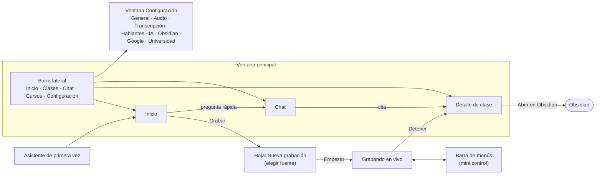

# Plan de diseño: Oyente

> [!info] Nombre de la app
> El nombre visible es una **variable de marca**: en este documento y en la UI se escribe `{nombre}` (hoy = **"Oyente"**), y sale de un único `branding.toml` (ver [[plan-fases]] §6.5). Los identificadores internos (paquete `transcriptor`, carpeta `.transcriptor/` de la bóveda, marcadores `%% transcriptor:… %%`) **no cambian**.

> [!summary] Resumen
> App de escritorio que **se siente nativa de macOS** (barra lateral, hojas modales, ventana de Configuración con pestañas, icono en la barra de menús) y que en **Windows 11** adopta las convenciones de ese sistema sin cambiar la estructura. Una sola acción principal, **Grabar**, siempre visible.
>
> **Mocks interactivos:** lienzo "Diseño de vistas" (enlace en el chat de la sesión; copia local en `docs/diseno/mocks/project/`). En modo *Play* los botones y la barra lateral navegan entre pantallas.

---

## 1. Principios

1. **Grabar está a un clic** desde cualquier pantalla (botón rojo arriba a la derecha y atajo global `⌥⌘R` / `Ctrl+Alt+R`).
2. **La transcripción es la protagonista.** Texto grande (15 px), mucho aire y etiquetas de hablante claras. Todo lo demás (sugerencias, IA) va en paneles laterales que se pueden ocultar.
3. **Nada bloquea.** Sin API key, sin internet o con un error de la IA, la app sigue transcribiendo. Los avisos son franjas o insignias, nunca diálogos que interrumpen.
4. **Lenguaje claro.** Sin jerga ("API key" es la única excepción y siempre trae una guía). Cada ajuste explica su efecto ("≈ 22 MB por hora").
5. **Transparencia de costos.** Cada respuesta de IA indica cuánto consumió; las respuestas locales dicen "sin IA · 0 tokens".
6. **Accesible:** contraste ≥ 4,5:1, objetivos táctiles ≥ 28 px en escritorio (44 px en el botón principal), todo usable con teclado, los colores de hablante siempre acompañados de su nombre.

---

## 2. Mapa de navegación

---

## 3. Vistas

| # | Vista | Dónde | Contenido principal | Mock |
|---|-------|-------|---------------------|------|
| 1 | **Inicio** | Ventana principal | Próxima clase (leída de Google Calendar) con **Grabar ahora**, tarjeta de recomendación de Canvas (no bloqueante), tareas pendientes con su estado en Google Tasks, clases recientes, barra de pregunta rápida al chat | `Main` |
| 2 | **Nueva grabación** | Hoja modal sobre la ventana | Curso, fuente de audio (aplicación *recomendada*, pestaña, sistema, solo micrófono), lista de apps que están sonando, incluir micrófono con nivel, resumen de cómo se guardará el audio | `Fuente` |
| 3 | **Grabando** | Ventana principal en modo enfoque (sin barra lateral) | Temporizador, fuente, medidores de nivel, Marcar momento / Pausar / Detener; transcripción en vivo con *Profesor / Yo / Participante*; panel de **Sugerencias** con interruptor | `Grabando` |
| 4 | **Barra de menús** | Icono en la barra de menús de macOS / bandeja de Windows | Estado, tiempo, niveles, última frase, tarea detectada, Pausar / Detener, atajos | `BarraMenu` |
| 5 | **Detalle de clase** | Ventana principal | Confirmación de la voz del profesor (solo primera clase), reproductor con estado de retención del audio, resumen, puntos importantes con minuto, tareas con estado en Tasks y aviso de Canvas ("ya está en Canvas" / "las fechas no coinciden"), temas y **relaciones de Obsidian**, transcripción final con filtro por hablante | `Clase` |
| 6 | **Chat** | Ventana principal | Historial de conversaciones, alcance (todas las clases / un curso / esta semana), respuestas con citas al minuto, tarjeta **"Agregar como: Tarea (Tasks) / Recordatorio (Calendar)"** para confirmar, indicador de tokens o "modo local" | `Chat` (ajuste *sinApiKey* muestra el modo local) |
| 7 | **Configuración** | Ventana aparte con pestañas en la barra de herramientas | Ver §5 | `AjustesAudio`, `AjustesIA`, `AjustesGoogle`, `AjustesUniversidad` |
| 8 | **Asistente** | Ventana propia la primera vez | 6 pasos con progreso lateral (el 4 es "Conectar con Google", opcional); descarga del modelo de voz en paralelo | `Asistente` |
| 9 | **Windows** | — | Misma estructura con convenciones de Windows 11 | `Windows` |

### ¿Dónde está el chat?
- **Sección propia** en la barra lateral (pantalla completa, con historial).
- **Acceso rápido** desde Inicio: barra "Pregúntale algo a tus clases…" con preguntas sugeridas.
- **Durante la grabación**: desde la barra de menús ("Preguntar en el chat", `⌘2`), sin interrumpir la grabación.

### ¿Dónde están las configuraciones?
- **macOS:** menú *{nombre} → Configuración…* (`⌘,`), y el enlace **Configuración** al pie de la barra lateral. Se abre como **ventana aparte** con pestañas de iconos, al estilo de *Ajustes* de las apps de Mac.
- **Windows:** misma entrada al pie de la barra lateral y `Ctrl+,`. Se abre dentro de la ventana principal como página con navegación lateral (convención de Windows 11).
- Accesos directos contextuales: "Cambiar" junto a la fuente o al formato de audio lleva a la pestaña correspondiente.

---

## 4. Estados especiales

| Estado | Cómo se ve |
|--------|-----------|
| Sin API key / modo local | Insignia gris "Modo local" en el chat; tareas "A confirmar"; clases con insignia "Sin resumen"; el panel de sugerencias no aparece |
| IA falla durante la clase | El panel de sugerencias muestra "Sugerencias no disponibles"; la transcripción no se detiene |
| Límite de gasto alcanzado | Franja informativa en Inicio: "Llegaste al límite del mes; la app sigue en modo local" |
| Fuente de audio se cierra | Franja ámbar en Grabando: "Chrome dejó de sonar. ¿Cambiar de fuente?" con botón; el temporizador sigue |
| Primera clase de un curso | Franja morada en el detalle: "¿Esta es la voz del profesor?" con Escuchar / Sí / No |
| Tarea ya publicada en Canvas | Franja verde en la tarjeta de confirmación: "Ya está en Canvas con fecha 19/10. No se duplicará." |
| Fechas que no coinciden con Canvas | Franja ámbar bajo la tarea: "El profesor dijo jueves 15, Canvas dice viernes 16" |
| Google sin conectar | Configuración → Google muestra solo "Conectar con Google"; las tareas se ofrecen como archivo `.ics` |
| Palabras dudosas | Resaltado amarillo en la transcripción + insignia "N por revisar" |
| Descarga de modelos | Barra de progreso al pie del asistente y en la tarjeta de estado de la barra lateral |

---

## 5. Configuración (pestañas)

| Pestaña | Contenido |
|---------|-----------|
| General | Carpeta compartida / bóveda, idioma de la app, iniciar al encender el equipo, atajo global |
| **Audio** | Fuente por defecto, app preferida, micrófono; **Guardar audio** (Siempre / 30 días / Nunca); **Formato** (Opus ≈ 11 MB/h por canal, FLAC ≈ 60 MB/h por canal) con **estimación de espacio en vivo**; dónde guardarlo; por curso; extensión del navegador (opcional) |
| Transcripción | Modelo (Automático), idioma y glosario por curso, re-transcribir |
| Hablantes | Identificar profesor (siempre activo), distinguir participantes, umbral, borrar perfiles de voz, token opcional de Hugging Face |
| **IA** | Proveedor (Claude / Gemini / Local / Ninguno), API key con "Probar conexión", respaldo, modelo por tarea, procesar clases pendientes, sugerencias en vivo (interruptor, intervalo, máximo por clase), límite mensual de gasto |
| Obsidian | Carpetas de clases, temas y profesores; tipos de relación; umbral de "relacionadas"; carpetas excluidas; Reconstruir relaciones |
| **Google** | Botón "Conectar con Google" (no hay login para usar la app); funciones con permiso propio: leer horario, recordatorios en el calendario "Clases – {nombre}", Google Tasks (lista "Tareas de clase"); avisar antes de clase; antelación; agregar sin preguntar; tarjeta de Canvas |
| **Universidad** | Guía para importar el calendario de actividades con selector Canvas / Moodle / Blackboard / Otra; pegar enlace ICS para leerlo localmente; comparar fechas; crear tareas en Tasks desde Canvas |

---

## 6. Google y calendarios de la universidad

Alineado con el plan funcional v0.4 (§9). **No hay login para usar la app**; Google se conecta desde un botón opcional en el asistente (paso 4) y en Configuración → Google. Cada función pide su permiso cuando se activa.

| Función (v1) | Dónde se ve en el diseño |
|--------------|--------------------------|
| Leer el horario de Google Calendar | Inicio ("Próxima clase · en 25 min"), aviso "Cálculo II empieza en 5 min. ¿Grabar?" |
| Recordatorios en el calendario "Clases – {nombre}" | Tarjeta "Agregar como" (Chat, sugerencias en vivo, detalle de clase) |
| Tareas en Google Tasks ("Tareas de clase") | Misma tarjeta; estado "En Tasks" en Inicio y en la clase; completar en Tasks marca la casilla en Obsidian |
| Calendario de Canvas / Moodle / Blackboard | Tarjeta de recomendación no bloqueante (Inicio y Configuración → Google): **Ver cómo hacerlo · Ya lo hice · Ahora no**; guía en Configuración → Universidad |
| Cruce con Canvas | Avisos "Ya está en Canvas" (verde) y "Las fechas no coinciden" (ámbar) |

**Gmail no entra en la v1.** Leerlo requiere un permiso restringido de Google con auditoría de seguridad anual de pago; enviar el resumen por correo queda para más adelante. Los mocks ya no muestran Gmail.

**Google Drive:** no hace falta conectarlo; la carpeta compartida puede ser una carpeta de *Google Drive para escritorio*.

---

## 7. Sistema visual

### 7.1 Colores (modo claro)

| Token | macOS | Windows | Uso |
|-------|-------|---------|-----|
| `fondo` | `#FFFFFF` | `#FAFAFA` | Contenido |
| `fondo-lateral` | `#F2F1EF` | `#F3F3F3` | Barra lateral, barras de herramientas |
| `borde` | `#E6E4E1` | `#E5E5E5` | Tarjetas y separadores |
| `texto` | `#1D1D1F` | `#1B1B1B` | Texto principal |
| `texto-2` | `#55555A` | `#5F5F5F` | Texto secundario (≥ 4,5:1) |
| `acento` | `#0A6CDB` | `#005FB8` | Enlaces, selección, botones primarios. En la app real se usa el **color de acento del sistema** |
| `grabar` | `#D92D3A` | `#C42B1C` | Solo para grabar o "Grabando" |
| `profesor` | `#4B2FB0` sobre `#EFEBFB` | igual | Etiqueta de hablante |
| `yo` | `#0A5BBE` sobre `#E6EFFB` | igual | Etiqueta de hablante |
| `participante` | `#4A4A4F` sobre `#EEEDEB` | igual | Etiqueta de hablante |
| `revisar` | fondo `#FFF3A8` | igual | Palabras de baja confianza |
| `ok` | `#1F7A46` / punto `#1F9D55` | igual | Estados correctos |

**Modo oscuro:** obligatorio. Se siguen los colores del sistema (`prefers-color-scheme`); los tokens se redefinen en oscuro manteniendo los mismos contrastes. Pendiente de mock.

### 7.2 Tipografía
- **macOS:** San Francisco (fuente del sistema, `-apple-system`).
- **Windows:** Segoe UI Variable.
- Escala: 11 (etiquetas) · 12 (metadatos) · 13 (base) · 15 (transcripción y títulos de sección) · 17 · 22 (título de clase) · 24 (asistente).
- Números de tiempo con `tabular-nums` para que el temporizador no "baile".

### 7.3 Forma y espacio
- Radios: 7–8 px en controles, 10–14 px en tarjetas, 12 px en ventanas (macOS); 4 px en controles y 8 px en tarjetas (Windows).
- Rejilla de 4 px; márgenes de contenido de 24–28 px.
- Iconos de línea de 16 px (1,5 px de trazo). En la app real: **SF Symbols** en macOS y **Fluent icons** en Windows.

---

## 8. macOS vs. Windows

| Elemento | macOS | Windows 11 |
|----------|-------|-----------|
| Controles de ventana | Semáforo arriba a la izquierda, integrado en la barra lateral | Minimizar / maximizar / cerrar a la derecha en una barra de título propia |
| Fondo de la barra lateral | Translúcido (*vibrancy*) | Material *Mica* |
| Configuración | Ventana aparte con pestañas de iconos (`⌘,`) | Página dentro de la app (`Ctrl+,`) |
| Diálogos | Hojas que bajan desde la barra de título | Diálogos centrados |
| Control mientras graba | Icono en la barra de menús con popover | Icono en la bandeja del sistema con menú flotante |
| Atajos | `⌘` | `Ctrl` |
| Botón primario | Radio 8 px, acento del sistema | Radio 4 px, acento del sistema |
| Captura por aplicación | ScreenCaptureKit (pide permiso de *Grabación de pantalla y audio*) | Process loopback de WASAPI (sin permisos extra) |

La estructura, el orden de las pantallas y los textos son **idénticos** en ambos sistemas; solo cambian los componentes de "piel" (*chrome*).

---

## 9. Implementación con NiceGUI + pywebview

- Ventana nativa con `pywebview`: en macOS, barra de título **oculta con el semáforo integrado** (*hidden inset*); en Windows, ventana sin marco con barra de título propia y botones de sistema.
- Tema por plataforma: un archivo de tokens CSS por sistema (`theme-mac.css`, `theme-win.css`) elegido al iniciar; los componentes usan solo los tokens.
- Icono de barra de menús / bandeja: `pystray` (o `rumps` en macOS).
- Atajo global: `pynput` / API nativa por plataforma.
- La ventana de Configuración en macOS es una segunda ventana de `pywebview`.
- Componentes reutilizables (igual que en los mocks): `Sidebar`, `SettingsTabs`, `SpeakerLabel`, `TaskRow`, `SuggestionCard`, `SourceOption`, `RecordButton`.

---

## 10. Pendiente de diseñar
- Mocks en **modo oscuro**.
- Pantallas de Configuración: General, Transcripción, Hablantes y Obsidian.
- Lista completa de **Clases** (filtros por curso, búsqueda, estados).
- Vista de un **curso** (`_Curso.md` en la app: horario, profesor, glosario).
- Guía con capturas para conseguir la API key e instalar la extensión.
- Estados vacíos (primera vez sin clases) y de error detallados.
- **Icono** de la app (pendiente, D4). El nombre ya está decidido: `{nombre}` = "Oyente", configurable en `branding.toml`.
- En los mocks, el nombre es el ajuste **Marca → nombre** de las pantallas donde aparece (asistente, barra de título de Windows, Configuración → Google).
