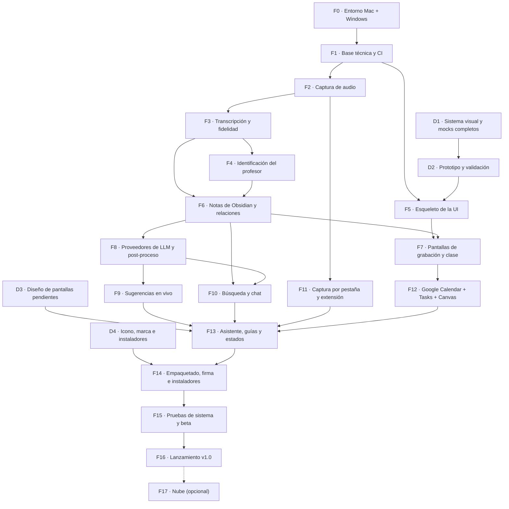
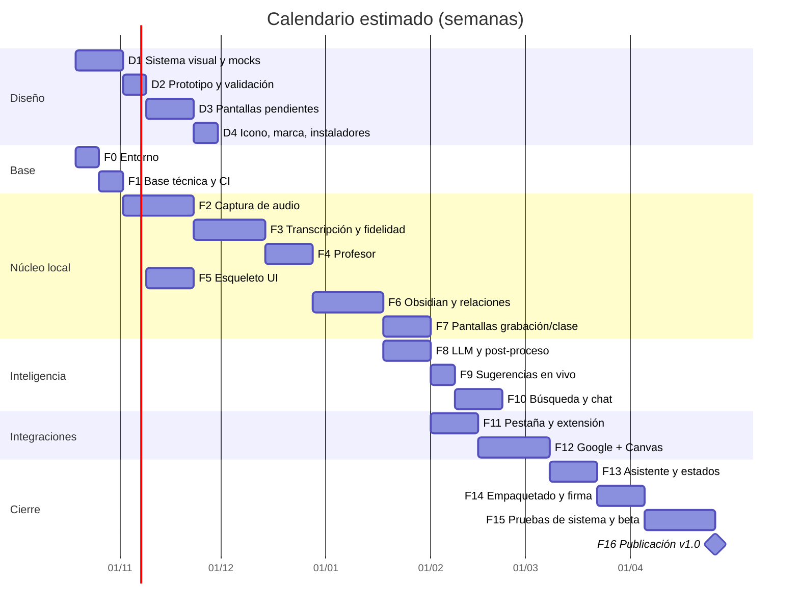
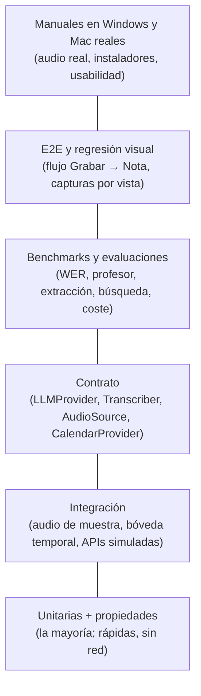

# Plan de fases de implementación

> [!summary] Resumen
> Este documento ordena **todo** lo definido en [[plan-transcriptor]] (funcionalidad, v0.4) y [[plan-diseno]] (diseño, v0.2) en fases implementables, cada una con sus **entregables, pruebas obligatorias y criterio de "hecho"**.
>
> - **Se desarrolla en un Mac (Apple Silicon)**, pero **la mayoría de usuarios usará Windows**. Por eso Windows es la **plataforma principal de pruebas** desde el primer día: cada cambio se prueba automáticamente en Windows y en macOS, y cada fase incluye una prueba manual en un equipo Windows real.
> - El diseño avanza **en paralelo** (fases D1–D4), siempre una fase por delante de la implementación de la pantalla correspondiente.
> - El código vive en un **repositorio privado de GitHub** en la cuenta asociada a `mcanil1999@gmail.com`. Se crea en **F1**, no al final, porque el equipo Windows del dueño **descarga el código desde GitHub** para probar cada fase y **compilar el instalador**. El inicio de sesión lo hace el propio dueño de la cuenta; la contraseña nunca se escribe en el proyecto, en archivos ni en el chat.
> - La app **no se venderá por ahora, pero queda lista para venderse** (§6): licencia propietaria, dependencias compatibles con uso comercial, cada usuario usa su propia API key, y documentos legales y firma preparados.

---

## 0. Cómo leer este plan

| Prefijo | Tipo de fase |
|---------|--------------|
| **D1–D4** | Diseño (en paralelo con el desarrollo) |
| **F0–F15** | Implementación |
| **F16** | Lanzamiento v1.0 (el repositorio privado existe desde F1) |
| **T** | Pruebas: cada fase tiene las suyas; la estrategia completa está en §4 |

**Regla general de cada fase ("Definición de hecho"):**
1. Código revisado y fusionado en `main` mediante Pull Request.
2. **CI en verde en Windows y macOS** (lint, tipos, pruebas).
3. Las pruebas listadas en la fase existen y pasan.
4. Prueba manual en **Windows 11 x64 real** registrada en la lista de comprobación (`docs/pruebas/manual-<fase>.md`).
5. Documentación de usuario actualizada si la fase cambia algo visible.
6. Ninguna fase rompe la regla de oro: **la transcripción funciona sin API key y sin internet**.

---

## 1. Mapa de fases



### Calendario estimado
Estimación para **una persona** a tiempo parcial con ayuda de Claude Code. Es orientativo y se recalcula al cerrar cada fase.



**Hitos:**
| Hito | Después de | Qué se puede hacer |
|------|-----------|--------------------|
| **M1 · "Solo transcribir"** (alfa interna) | F7 | Grabar una clase en Windows y obtener la nota de Obsidian relacionada, sin API key |
| **M2 · "Con IA"** | F10 | Resumen, tareas, sugerencias en vivo y chat |
| **M3 · "Integrado"** | F12 | Google Calendar, Tasks y cruce con Canvas |
| **M4 · Beta** | F14 | Instaladores firmados para usuarios de prueba |
| **M5 · v1.0** | F16 | Release privado en GitHub con instaladores |

---

## 2. Fases de diseño

### D1 · Sistema visual y mocks completos
**Parte de:** mocks actuales en `docs/diseno/mocks/project/` y [[plan-diseno]] §3–§8.

**Entregables**
- Tokens de diseño definitivos (colores, tipografía, espacios, radios) en **un único archivo fuente** del que se generan `theme-mac.css` y `theme-win.css`.
- **Modo oscuro** para todas las vistas existentes.
- Biblioteca de componentes documentada: `Sidebar`, `SettingsTabs`, `SpeakerLabel`, `TaskRow`, `SuggestionCard`, `SourceOption`, `RecordButton`, franjas de estado, tarjeta "Agregar como", tarjeta de Canvas.
- Variante Windows 11 de cada vista (no solo `Windows.dc.html`): barra de título propia, bandeja del sistema, Configuración como página dentro de la ventana.

**Pruebas de diseño**
- Contraste ≥ 4,5:1 en claro y oscuro (verificación automática de los tokens).
- Revisión a 100 %, 125 % y 150 % de escala (las escalas habituales en portátiles Windows).
- Todos los textos caben en español (no hay inglés de relleno) y con nombres de curso largos ("Ecuaciones Diferenciales Ordinarias II").

**Hecho cuando:** cada vista de [[plan-diseno]] §3 tiene versión Mac, Windows, claro y oscuro.

### D2 · Prototipo navegable y validación
- Prototipo interactivo con los mocks (modo *Play*).
- **Prueba con 3–5 estudiantes, la mayoría en Windows**, con tareas concretas: "graba la clase solo desde Chrome", "encuentra la tarea de Cálculo", "cambia el formato de audio a Opus", "conecta Google".
- Registro de problemas por gravedad y ajustes de los mocks.

**Hecho cuando:** ≥ 4 de 5 participantes completan las tareas principales sin ayuda.

### D3 · Pantallas pendientes
De [[plan-diseno]] §10:
- Pestañas de Configuración **General, Transcripción, Hablantes y Obsidian**.
- Lista completa de **Clases** (filtros por curso, búsqueda y estados: sin resumen, por revisar, LLM pendiente).
- Vista de **Curso** (horario, profesor, glosario, perfil de voz, retención por curso).
- **Guías con capturas**: conseguir API key (Claude y Gemini), instalar la extensión del navegador, importar el calendario de Canvas/Moodle/Blackboard, permisos de audio de macOS.
- **Estados vacíos** (primera vez sin clases) y **de error** detallados (sin audio, sin permisos, disco lleno, modelo sin descargar, Google desconectado).
- Aviso "Tu clase empieza en 5 min" (notificación del sistema en Mac y Windows).

### D4 · Identidad e instaladores
- **Nombre de la app: Oyente** (elegido; se puede cambiar, §6.5). Pendiente: búsqueda formal de marcas y dominio antes de cualquier venta.
- Icono (`.icns` para Mac, `.ico` con todos los tamaños para Windows, icono monocromo para la barra de menús y la bandeja).
- Pantallas del instalador de Windows y fondo del `.dmg`.
- Pantalla de consentimiento de Google (logo, nombre y enlaces que exige la verificación de §F12).
- Página del proyecto en GitHub (README con capturas) y política de privacidad.

---

## 3. Fases de implementación

### F0 · Entorno de desarrollo (Mac) y de pruebas (Windows)

**Mac (desarrollo)**
- Instalar `uv` y con él **Python 3.12** (el Mac tiene 3.14 del sistema; el proyecto fija 3.12 en `.python-version` por compatibilidad con las librerías de voz).
- Instalar `git`, `gh` (CLI de GitHub), `ffmpeg` y Obsidian.
- Bóveda de Obsidian de pruebas (`~/Obsidian/Pruebas Transcriptor`), separada de la real.

**Windows (pruebas), porque la mayoría de usuarios lo usará**

| Opción | Uso | Limitación |
|--------|-----|-----------|
| **GitHub Actions `windows-latest`** | Todas las pruebas automáticas de cada PR | Sin dispositivos de audio ni GPU: las pruebas de audio usan archivos y dispositivos simulados |
| **PC Windows del dueño** (x64, disponible) | Prueba manual de cada fase: audio real, WASAPI, Chrome/Edge, instalador, SmartScreen | — |
| Máquina virtual Windows 11 ARM (UTM/Parallels) en el Mac | Comprobaciones rápidas de UI e instalador | Es ARM: no representa el x64 de los usuarios; audio virtualizado poco fiable; sin NVIDIA |
| Equipo con GPU NVIDIA (opcional) | Probar el camino CUDA de `faster-whisper` | — |

- En el PC Windows: instalar **Git for Windows**, **GitHub CLI** (`winget install GitHub.cli`), `uv`, Obsidian, Chrome y Edge. Iniciar sesión con `gh auth login` (lo hace el dueño) y clonar el repositorio privado: `gh repo clone transcriptor`.
- Ciclo de trabajo: **Mac → `git push` → PC Windows → `git pull` → pruebas manuales e instalador**.
- Bóveda de pruebas también en Windows, **dentro de una carpeta de OneDrive o Google Drive** (caso típico de usuarios Windows) y con tildes en la ruta.

**Hecho cuando:** el Mac y el equipo Windows ejecutan el "hola mundo" de F1.

---

### F1 · Base técnica, repositorio privado y CI

**Entregables**
- Repositorio git con la estructura de [[plan-transcriptor]] §11, `pyproject.toml`, `uv.lock` y `.gitignore` de §12.
- **Repositorio privado en GitHub** (cuenta de `mcanil1999@gmail.com`):
  1. El dueño inicia sesión en el Mac con `! gh auth login` (navegador; contraseña y 2FA solo en la web de GitHub).
  2. Revisión previa con `gitleaks`.
  3. Con **confirmación explícita del dueño**: `gh repo create oyente --private --source . --push` (si la app cambia de nombre, el repositorio se renombra y GitHub redirige el nombre anterior).
  4. Protección de `main` (PR obligatorio y CI en verde).
- **Archivo único de marca** `src/transcriptor/branding.toml` con el nombre visible ("Oyente") y sus derivados (§6.5); el resto del código lo lee de ahí.
- **Licencia propietaria** (`LICENSE`: "Todos los derechos reservados") y `THIRD_PARTY_NOTICES.md` generado automáticamente (§6).
- Identidad de commits: `git config user.email "mcanil1999@gmail.com"` (o la dirección *noreply* que GitHub asigne a esa cuenta, para no exponer el correo en el historial público; ver F16).
- `config/`: modelo de configuración (Pydantic) con valores por defecto, migraciones de versión de config y almacenamiento de secretos con `keyring` (Llavero en Mac, **Administrador de credenciales** en Windows).
- Registro (logs) rotativo con **filtro de secretos** (API keys, tokens de Google, enlaces ICS).
- Utilidad de **rutas multiplataforma** (`platformdirs`): datos de la app en `~/Library/Application Support` (Mac) y `%LOCALAPPDATA%` (Windows).
- Utilidad de **nombres de archivo seguros**: en Windows no se permiten `: * ? " < > |`, nombres reservados (`CON`, `NUL`…) ni espacios/puntos finales, y las rutas pueden superar 260 caracteres.
- `pre-commit`: `ruff`, `mypy`, `gitleaks`.
- **CI en GitHub Actions** pensado para un repositorio **privado**, que tiene minutos gratuitos limitados al mes y en el que los minutos de Windows y sobre todo de macOS cuentan varias veces más (verificar el cupo vigente del plan de la cuenta):
  - En cada PR: lint, tipos y pruebas en **`windows-latest`** (la plataforma de los usuarios).
  - macOS: se prueba **localmente en el Mac de desarrollo** con el mismo comando (`uv run pytest`); en CI solo al etiquetar versiones.
  - Caché de dependencias y modelos para ahorrar minutos.
- Scripts de compilación reproducibles: `scripts/build-windows.ps1` y `scripts/build-mac.sh`.
- "Hola mundo" empaquetado con PyInstaller **en el PC Windows** (`git pull` + `scripts\build-windows.ps1`) para descubrir pronto problemas de empaquetado y antivirus.

**Pruebas**
| ID | Prueba | Tipo |
|----|--------|------|
| T1.1 | La config se crea con valores por defecto, se guarda y se recarga igual | Unitaria |
| T1.2 | Migración de config v1 → v2 conserva los ajustes del usuario | Unitaria |
| T1.3 | Los secretos se guardan en el llavero y **nunca** en `config.yaml` | Unitaria (keyring simulado) + manual en Windows |
| T1.4 | El filtro de logs oculta API keys, tokens OAuth y URLs ICS | Unitaria |
| T1.5 | Nombres de archivo seguros: `"Clase: repaso?"` → válido en Windows; tildes y ñ conservadas; nombres reservados evitados | Unitaria (parametrizada) |
| T1.6 | Rutas con tildes, espacios y > 260 caracteres funcionan en Windows | Integración en `windows-latest` |
| T1.7 | El ejecutable "hola mundo" arranca en Windows limpio | Manual |
| T1.8 | El nombre "Oyente" solo aparece en `branding.toml` y `assets/branding/`; cambiar `branding.toml` cambia título, ejecutable e instalador (§6.5) | Unitaria (guardiana) |

---

### F2 · Captura de audio (las 4 fuentes) y retención

**Entregables** ([[plan-transcriptor]] §6.1, §6.2, §6.4)
- Interfaz `AudioSource` y fuentes:

| Fuente | Windows (prioridad) | macOS |
|--------|---------------------|-------|
| Micrófono | `sounddevice` (WASAPI) | `sounddevice` (CoreAudio) |
| Todo el sistema | WASAPI loopback | ScreenCaptureKit (macOS 13+) |
| **Solo una aplicación** (por defecto) | *Process loopback* de WASAPI (Windows 10 2004+ / 11), lista de apps que están sonando | ScreenCaptureKit filtrado por app |
| Pestaña del navegador | F11 | F11 |

- Grabación en **dos canales separados** (clase y micrófono), 16 kHz mono, a FLAC temporal con escritura continua (sin pérdida si la app se cierra).
- Detección de fuente perdida (app cerrada) → pausa del canal y evento para la UI, **sin cortar la sesión**.
- Silero VAD: segmentación en frases.
- `AudioRetentionPolicy`: **Siempre / N días / Nunca**, por defecto y por curso; nunca borra si la pasada final falló.
- Conversión a **Opus** o conservación en **FLAC** según la elección del usuario; cálculo del **peso estimado** (≈ 60 MB/h por canal en FLAC, ≈ 11 MB/h en Opus) y del tamaño real de cada sesión.
- Permisos de macOS (Grabación de pantalla y audio, Micrófono) con detección de estado; en Windows, detección de "acceso al micrófono desactivado" en Privacidad.

**Pruebas**
| ID | Prueba | Tipo |
|----|--------|------|
| T2.1 | `FileAudioSource` (simulada) alimenta el pipeline igual que una fuente real | Unitaria |
| T2.2 | VAD: un audio de prueba con 10 frases y silencios produce 10 ± 1 segmentos | Unitaria con audio de muestra |
| T2.3 | Cierre abrupto (`kill`) a mitad de grabación → el FLAC hasta ese segundo es legible | Integración |
| T2.4 | Retención: Siempre / N días (reloj simulado) / Nunca; "Nunca" no borra si la pasada final falló | Unitaria |
| T2.5 | Opus generado ocupa ≈ 11 MB/h por canal (± 20 %) y FLAC ≈ 60 MB/h; la estimación de la UI coincide con el tamaño real | Integración |
| T2.6 | Fuente perdida → evento `SourceLost`; la sesión continúa con el micrófono | Unitaria |
| T2.7 | **Windows real:** capturar solo Chrome mientras suena música en Spotify → la música no aparece | Manual |
| T2.8 | **Windows real:** WASAPI loopback y micrófono a la vez durante 2 h sin cortes ni desfase > 100 ms | Manual (prueba larga) |
| T2.9 | **Mac:** ScreenCaptureKit por app + flujo de permisos la primera vez | Manual |
| T2.10 | Micrófono desactivado en Privacidad de Windows → mensaje claro con botón para abrir la configuración | Manual |

---

### F3 · Transcripción en vivo, pasada final y fidelidad

**Entregables** ([[plan-transcriptor]] §1, §4.1, §6.2, §6.4)
- Interfaz `Transcriber` con motores:
  - `FasterWhisperTranscriber` (**camino principal: Windows CPU `int8`** y NVIDIA `float16`).
  - `MlxWhisperTranscriber` (Mac Apple Silicon).
- **Detección automática de hardware** y elección de modelo (turbo en vivo; large-v3 en la pasada final; medium/small en equipos modestos).
- Descarga de modelos con progreso, reanudación y verificación (hash).
- Transcripción en vivo → `.txt` con `flush` por segmento; pasada final con `beam_size=5`, `temperature=0`, VAD, `condition_on_previous_text=False`, glosario del curso y marcas de tiempo por palabra.
- Confianza por palabra → marcas de palabras dudosas (`==palabra==`).
- Re-transcribir una clase desde su audio.
- **Banco de pruebas de fidelidad (WER):** set de audios de clases en español con transcripción revisada a mano (con permiso de quienes aparecen; fuera del repositorio o con Git LFS privado).

**Pruebas**
| ID | Prueba | Tipo |
|----|--------|------|
| T3.1 | Interfaz `Transcriber` con motor simulado: orden de segmentos, tiempos y escritura del `.txt` | Unitaria |
| T3.2 | Audio de 30 s con texto conocido → WER ≤ umbral con el modelo `small` (rápido para CI) | Integración (CI Windows y Mac) |
| T3.3 | **Benchmark WER** con large-v3 sobre el set de clases: se registra el valor por versión; **una subida de WER bloquea la fusión** | Benchmark (local / manual) |
| T3.4 | Silencio de 5 min → 0 frases inventadas (alucinaciones) | Integración |
| T3.5 | El glosario mejora nombres propios: WER de términos del glosario con y sin glosario | Benchmark |
| T3.6 | El `.txt` en vivo existe y crece durante la grabación; tras la pasada final el definitivo lo reemplaza y el de vivo queda como `.live.txt` | Integración |
| T3.7 | **Factor de tiempo real** en un **portátil Windows solo CPU** (i5/Ryzen 5, 8–16 GB): el modo en vivo va como máximo 5 s por detrás; la pasada final de 1,5 h termina en ≤ 1,5 h | Rendimiento (manual, equipo de referencia) |
| T3.8 | Detección de hardware elige el motor correcto en: Mac M-series, Windows CPU, Windows NVIDIA | Unitaria (simulada) + manual |
| T3.9 | Descarga de modelo interrumpida → se reanuda; archivo corrupto → se detecta y se vuelve a descargar | Integración |

---

### F4 · Identificación del profesor

**Entregables** ([[plan-transcriptor]] §6.3)
- `SpeakerIdentifier`: canal de micrófono = **Yo**; huella ECAPA-TDNN por frase; perfil del profesor por curso; etiquetas en vivo (**Profesor / Participante**).
- Pasada final: clustering; sin perfil → "el que más habla"; petición de confirmación (fragmento de 5 s).
- Corrección manual con un clic que actualiza el perfil; borrar perfiles.
- pyannote opcional (con token de Hugging Face).

**Pruebas**
| ID | Prueba | Tipo |
|----|--------|------|
| T4.1 | Segmentos del canal de micrófono siempre etiquetados "Yo" | Unitaria |
| T4.2 | Audio sintético con 2 voces conocidas → el profesor se identifica en ≥ 95 % de los segmentos | Integración |
| T4.3 | Primera clase sin perfil → el que más habla queda como Profesor y se emite la petición de confirmación | Unitaria |
| T4.4 | Corregir una etiqueta actualiza el perfil y mejora la clase siguiente | Integración |
| T4.5 | Set de clases reales: precisión de "Profesor" ≥ 95 % (meta de [[plan-transcriptor]] §17) | Benchmark |
| T4.6 | El perfil de voz no se escribe en la carpeta compartida y se borra al pedirlo | Unitaria |

---

### F5 · Esqueleto de la interfaz (NiceGUI + pywebview)

**Entregables** ([[plan-diseno]] §1–§3, §8, §9)
- Ventana nativa: en Mac, barra de título oculta con el semáforo integrado; en **Windows, ventana sin marco con barra de título propia** (minimizar, maximizar, cerrar, arrastrar, *snap layouts*).
- Temas `theme-mac.css` / `theme-win.css` desde los tokens de D1; claro/oscuro según el sistema.
- Barra lateral (Inicio · Clases · Chat · Cursos · Configuración) y navegación.
- Configuración: **ventana aparte con pestañas (Mac)** / **página con navegación lateral (Windows)**; `⌘,` / `Ctrl+,`.
- Icono en la **barra de menús (Mac)** / **bandeja del sistema (Windows)** con mini control.
- Atajo global `⌥⌘R` / `Ctrl+Alt+R`.
- Componentes reutilizables con los mismos nombres que en los mocks.
- Inicio con datos de ejemplo (todavía sin lógica real).

**Pruebas**
| ID | Prueba | Tipo |
|----|--------|------|
| T5.1 | Navegación entre todas las secciones (pruebas de UI con el *User fixture* de `nicegui.testing`) | UI automatizada |
| T5.2 | Tema correcto según plataforma y modo oscuro | UI automatizada |
| T5.3 | **Capturas de referencia** de cada vista (Mac y Windows, claro y oscuro) comparadas con las anteriores para detectar cambios no deseados | Regresión visual |
| T5.4 | Navegación completa solo con teclado; foco visible | Manual + automatizada |
| T5.5 | **Windows real** a 125 % y 150 % de escala: nada se corta ni se ve borroso | Manual |
| T5.6 | Bandeja de Windows y barra de menús de Mac: abrir, pausar, detener | Manual |
| T5.7 | Atajo global funciona con la app en segundo plano (y no choca con atajos comunes) | Manual |

---

### F6 · Notas de Obsidian, relaciones y modo sin API key

**Entregables** ([[plan-transcriptor]] §5.4, §7)
- `NoteWriter` con plantillas Jinja2: frontmatter, enlaces a minutos (`^t-hh-mm-ss`), tareas en formato del plugin Tasks, transcripción por hablante.
- Estructura de carpetas `Clases/`, `Temas/`, `Profesores/`, `_Curso.md`, `_Índice.md`; escritura atómica; SQLite fuera de la carpeta compartida.
- `LinkBuilder`: curso, anterior/siguiente (actualizando la anterior), profesor, temas normalizados (BGE-M3 + `rapidfuzz` + `aliases`), clases relacionadas, notas propias del usuario mencionadas; bloques `%% transcriptor:…%%`; carpetas excluidas; "Reconstruir relaciones".
- Indexado local de la bóveda y vigilante de archivos (`watchdog`).
- **Modo sin API key**: `NullLLMProvider`, temas con KeyBERT, "posibles tareas" por reglas + `dateparser` marcadas *a confirmar*, `llm_procesado: false`.

**Pruebas**
| ID | Prueba | Tipo |
|----|--------|------|
| T6.1 | **Notas de referencia (*golden files*)**: una sesión de ejemplo genera exactamente el `.md` esperado | Instantánea |
| T6.2 | El `.md` generado es válido: frontmatter YAML parseable, enlaces `[[...]]` resolubles, bloques `^id` únicos | Unitaria |
| T6.3 | **Nunca se modifica texto del usuario**: pruebas basadas en propiedades (`hypothesis`) con notas aleatorias del usuario → fuera de los bloques marcados y de las propiedades propias, el archivo queda idéntico byte a byte | Propiedades |
| T6.4 | Anterior/siguiente: crear tres clases fuera de orden → cadena correcta | Unitaria |
| T6.5 | "Integracion x partes" se une a la nota existente "Integración por partes" | Unitaria |
| T6.6 | Archivo modificado por el usuario mientras la app escribe → no se pisan sus cambios | Integración |
| T6.7 | Carpetas excluidas (`Privado/`) no se leen ni se enlazan | Unitaria |
| T6.8 | Sin API key: la clase completa genera nota, temas (KeyBERT), posibles tareas y relaciones **sin ninguna llamada de red** (la red se bloquea en la prueba) | Integración |
| T6.9 | Bóveda en **OneDrive/Google Drive en Windows** con tildes en la ruta: escritura atómica sin archivos duplicados de conflicto | Manual |
| T6.10 | La bóveda de pruebas abre en Obsidian: grafo, backlinks, plugin Tasks y Dataview muestran los datos | Manual |
| T6.11 | "Reconstruir relaciones" sobre una bóveda de 1.000 notas termina en < 5 min en el portátil Windows de referencia | Rendimiento |

---

### F7 · Pantallas de grabación y de clase (hito M1)

**Entregables** ([[plan-diseno]] vistas 2, 3, 4 y 5)
- Hoja **Nueva grabación**: curso, fuentes (aplicación recomendada), lista de apps sonando, incluir micrófono con nivel, resumen de retención y formato con peso estimado.
- Vista **Grabando**: temporizador, medidores, Marcar momento / Pausar / Detener, transcripción en vivo con etiquetas de hablante, franja de fuente perdida.
- **Detalle de clase**: confirmación del profesor, reproductor con estado de retención, resumen/puntos/tareas/temas, relaciones de Obsidian, transcripción con filtro por hablante, palabras dudosas, "Abrir en Obsidian", "Conservar/Borrar audio", re-transcribir.
- Pestañas de Configuración **Audio, Transcripción, Hablantes, Obsidian y General**.
- Lista de **Clases** y vista de **Curso**.

**Pruebas**
| ID | Prueba | Tipo |
|----|--------|------|
| T7.1 | Flujo completo automatizado con `FileAudioSource`: Grabar → Detener → nota creada y visible en Detalle | E2E automatizada (Windows y Mac) |
| T7.2 | Cambiar formato/retención actualiza la estimación de espacio en vivo | UI automatizada |
| T7.3 | "Abrir en Obsidian" abre la nota correcta (`obsidian://`) en Mac y Windows | Manual |
| T7.4 | **Prueba de aceptación M1 en Windows real:** clase real de 1 h por Meet en Chrome, captura "solo Chrome", **sin API key** → nota relacionada, profesor identificado, `.txt` fiel | Aceptación manual |

---

### F8 · Proveedores de LLM y post-proceso

**Entregables** ([[plan-transcriptor]] §5, §6.4, §8.2)
- `LLMProvider` + adaptadores con SDK oficiales: `AnthropicProvider`, `GeminiProvider`, `OllamaProvider`, `NullLLMProvider`, `FallbackProvider`.
- Niveles (`economico` / `estandar` / `maximo`) → modelos en `config.yaml` (por defecto Claude: `claude-haiku-5-5` para extracción, `claude-sonnet-5-5` para chat, `claude-opus-5-5` como máximo).
- Salida estructurada nativa de cada proveedor + validación Pydantic + 1 reintento + respaldo.
- Particularidades absorbidas por el adaptador: sin *prefill*, sin `tool_choice` forzado, `effort` en lugar de desactivar el razonamiento, manejo de `stop_reason == "refusal"`, caché de prompt, errores normalizados.
- `PostProcessor`: **una** llamada por clase (o *map-reduce* en clases > 2 h); Batch API para "Procesar clases pendientes".
- Contador de tokens, **límite mensual de gasto** y paso automático a modo local al alcanzarlo.
- Pestaña **IA** de Configuración con "Probar conexión".

**Pruebas**
| ID | Prueba | Tipo |
|----|--------|------|
| T8.1 | **Suite de contrato**: la misma batería se ejecuta contra cada adaptador con respuestas grabadas (sin red en CI) | Contrato |
| T8.2 | Suite de contrato **en vivo** con claves reales (manual o programada, nunca en PR públicos; presupuesto acotado) | Contrato en vivo |
| T8.3 | JSON inválido → reintento → respaldo; nunca llega un error a la UI | Unitaria |
| T8.4 | Rechazo de seguridad, límite de uso (429), sin internet y clave inválida → error normalizado y modo local | Unitaria |
| T8.5 | Cambiar de Claude a Gemini en Configuración no cambia el formato de la nota (misma instantánea) | Integración |
| T8.6 | Límite mensual alcanzado → no se hacen más llamadas y aparece la franja informativa | Unitaria |
| T8.7 | Caché de prompt: en la segunda clase, `cache_read_input_tokens > 0` (Claude) | Contrato en vivo |
| T8.8 | **Calidad de extracción**: set de 20 transcripciones con tareas/fechas anotadas a mano → precisión y exhaustividad de tareas ≥ 90 %; se compara Haiku vs. Sonnet vs. Gemini para fijar los valores por defecto | Evaluación |
| T8.9 | Coste medio por clase de 1,5 h medido y documentado por proveedor | Evaluación |
| T8.10 | La API key nunca aparece en logs, config ni mensajes de error | Unitaria |

---

### F9 · Sugerencias en vivo

**Entregables** ([[plan-transcriptor]] §6.5)
- `LiveAssistant` asíncrono: disparadores por palabras clave, intervalo N min, solo texto nuevo + estado corto, modelo económico, tope por clase, interruptor en la pantalla de grabación.
- Panel de sugerencias (tareas, puntos importantes, preguntas, clases relacionadas sin tokens).
- El resumen final reutiliza los resultados parciales.

**Pruebas**
| ID | Prueba | Tipo |
|----|--------|------|
| T9.1 | Decir "la tarea es para el jueves" dispara una llamada inmediata | Unitaria |
| T9.2 | Tope por clase respetado; al llegar, se pausan las sugerencias con aviso | Unitaria |
| T9.3 | Un LLM lento o caído **no retrasa** la transcripción (latencia del texto en vivo igual con y sin sugerencias) | Integración |
| T9.4 | Coste total de una clase con sugerencias ≤ 1,3 × el coste sin sugerencias | Evaluación |
| T9.5 | Sin API key el panel no aparece | UI automatizada |

---

### F10 · Búsqueda y chat (hito M2)

**Entregables** ([[plan-transcriptor]] §8; [[plan-diseno]] vista 6)
- Índice híbrido SQLite FTS5 + `sqlite-vec` + BGE-M3; reranker opcional.
- Enrutador por reglas: tareas → SQL (0 tokens); recordatorios → flujo de calendario; resto → RAG con top-k pequeño, resúmenes primero, citas al minuto.
- Historial recortado; alcance (todas / curso / semana).
- **Modo búsqueda** sin API key (fragmentos con enlaces).
- Vista **Chat** con indicador de tokens o "sin IA · 0 tokens"; pregunta rápida desde Inicio y desde la barra de menús.

**Pruebas**
| ID | Prueba | Tipo |
|----|--------|------|
| T10.1 | "¿Qué tareas tengo de Cálculo esta semana?" → respuesta por SQL con **0 llamadas al LLM** | Integración |
| T10.2 | Búsqueda: set de 30 preguntas con la clase/minuto correcto anotado → el fragmento correcto está en el top-5 en ≥ 90 % | Evaluación |
| T10.3 | Las respuestas del LLM citan clases que existen y minutos válidos (no inventa citas) | Evaluación |
| T10.4 | Tokens enviados por pregunta abierta ≤ 4.000 de media | Evaluación |
| T10.5 | Sin API key: modo búsqueda devuelve fragmentos y enlaces | Integración |
| T10.6 | Búsqueda con y sin tildes ("integracion" encuentra "integración") | Unitaria |

---

### F11 · Captura por pestaña del navegador y extensión

**Entregables** ([[plan-transcriptor]] §6.1.1)
- Página local `http://localhost:<puerto>/captura` con `getDisplayMedia` + AudioWorklet + WebSocket local (`BrowserTabSource`).
- Extensión Chrome/Edge (`chrome.tabCapture`) **incluida en el instalador**, con **detección** desde la app y **guía de instalación manual** ("Modo de desarrollador → Cargar descomprimida").
- Recomendación no bloqueante solo cuando se elige "Una pestaña"; por defecto se sigue usando la captura por aplicación.
- Aviso de actualización de la extensión cuando cambia la versión de la app.

**Pruebas**
| ID | Prueba | Tipo |
|----|--------|------|
| T11.1 | El servidor WebSocket local solo acepta conexiones de `localhost` y de la extensión (token por sesión) | Unitaria / seguridad |
| T11.2 | Flujo de audio simulado por WebSocket → segmentos transcritos | Integración |
| T11.3 | Extensión instalada → la app la detecta y no vuelve a recomendarla | Integración |
| T11.4 | **Windows real:** Meet en Chrome y en Edge, solo esa pestaña; música en otra pestaña no se captura | Manual |
| T11.5 | Firefox → la app ofrece "Solo una aplicación" automáticamente | Manual |
| T11.6 | Cerrar la pestaña a mitad de clase → franja "Chrome dejó de sonar" y la sesión sigue | Manual |
| T11.7 | Guía de instalación manual seguida por una persona no técnica en Windows en < 3 min | Usabilidad |

---

### F12 · Google Calendar + Tasks y calendario de la universidad (hito M3)

**Entregables** ([[plan-transcriptor]] §9; [[plan-diseno]] §6)
- Proyecto en Google Cloud, pantalla de consentimiento y cliente OAuth de escritorio (PKCE, *loopback*), tokens en el llavero, **autorización incremental**.
- Leer horario → aviso "Tu clase empieza en 5 min" (notificación del sistema en Mac y Windows), curso preseleccionado, inicio/fin automático opcional.
- Calendario propio **"Clases – Transcriptor"** y lista de Tasks **"Tareas de clase"**; tarjeta **"Agregar como: Tarea / Recordatorio"**; sin duplicados; sincronización de tareas completadas hacia Obsidian.
- **Tarjeta de recomendación de Canvas** (Inicio y Configuración → Google) y guía Canvas/Moodle/Blackboard/Otra; abrir `addbyurl` y copiar el enlace.
- Lector ICS local (enlace en el llavero), cruce de fechas ("Ya está en Canvas" / "Las fechas no coinciden"), opción "Crear tareas en Tasks desde Canvas".
- Exportar `.ics` si no hay Google.
- **Solicitud de verificación** de la app OAuth (se inicia aquí porque tarda semanas; requiere la política de privacidad y la pantalla de consentimiento de D4).

**Pruebas**
| ID | Prueba | Tipo |
|----|--------|------|
| T12.1 | APIs de Google simuladas: crear evento/tarea con id determinista; segunda vez → no duplica | Unitaria |
| T12.2 | Solo se piden los permisos de las funciones activadas | Unitaria |
| T12.3 | Parser ICS con archivos reales anonimizados de **Canvas, Moodle y Blackboard** (zonas horarias, eventos de día completo, caracteres especiales) | Unitaria con datos de muestra |
| T12.4 | Cruce: misma tarea con título distinto ("Hoja 4" vs. "Tarea 4 – Integrales") se reconoce; fechas distintas → aviso | Unitaria |
| T12.5 | Completar en Google Tasks → `- [x]` en Obsidian | Integración (API simulada) + manual |
| T12.6 | Desconectar Google revoca el token y borra el llavero | Integración |
| T12.7 | Sin Google: exportar `.ics` abre correctamente en Outlook (Windows) y en Calendario (Mac) | Manual |
| T12.8 | Aviso "Tu clase empieza en 5 min" aparece como notificación nativa en Windows 11 y macOS | Manual |
| T12.9 | El enlace ICS nunca aparece en logs ni en la bóveda | Unitaria |
| T12.10 | **Cuenta de Google de prueba real**: flujo completo conectar → horario → tarea → recordatorio | Manual |

---

### F13 · Asistente de primera vez, guías y estados

**Entregables** ([[plan-transcriptor]] §13; [[plan-diseno]] vista 8, §4; pantallas de D3)
- Asistente de 6 pasos (carpeta, cursos, IA o "Ninguno", Google opcional + tarjeta de Canvas, audio con permisos/retención/formato, relaciones de Obsidian) con descarga del modelo en paralelo.
- Guías con capturas (API key, extensión, Canvas, permisos de macOS).
- Todos los estados especiales de [[plan-diseno]] §4 y estados vacíos/de error de D3.
- Mensajes de error en lenguaje claro con acción sugerida.

**Pruebas**
| ID | Prueba | Tipo |
|----|--------|------|
| T13.1 | Asistente completo con "Omitir" en todos los pasos opcionales → la app queda funcional para transcribir | E2E automatizada |
| T13.2 | Cada estado especial de [[plan-diseno]] §4 se puede provocar y se ve como en el mock | UI automatizada + regresión visual |
| T13.3 | Disco lleno durante la grabación → aviso y el `.txt` no se corrompe | Integración |
| T13.4 | **Prueba de usabilidad** con 3–5 estudiantes no técnicos (mayoría Windows): instalar, configurar y grabar sin ayuda | Usabilidad |

---

### F14 · Empaquetado, firma e instaladores (hito M4)

**Entregables**
- **Windows (prioridad):** instalador `.exe` (Inno Setup o MSIX), compilado **en el PC Windows** (PyInstaller no compila de forma cruzada desde Mac):
  1. `git pull` del repositorio privado.
  2. `scripts\build-windows.ps1`: crea el entorno con `uv`, compila con PyInstaller, empaqueta con Inno Setup y firma si hay certificado.
  3. Resultado en `dist\Oyente-Setup-<versión>.exe` (el nombre sale de `branding.toml`).
  - Opcional: el mismo script en GitHub Actions al etiquetar una versión, si los minutos del plan alcanzan.
  - **Firma de código** (certificado de firma o Azure Trusted Signing) para reducir los avisos de **SmartScreen** y los falsos positivos de antivirus.
  - Comprobar el instalador con Windows Defender.
  - Si los antivirus siguen marcándolo, evaluar Nuitka como alternativa a PyInstaller.
- **macOS:** `.dmg` universal o arm64, firmado con Developer ID y **notarizado** por Apple; permisos declarados (`NSMicrophoneUsageDescription`, grabación de pantalla).
- Modelos **no incluidos** en el instalador (se descargan en el asistente) para que pese poco.
- Actualizaciones: aviso de nueva versión leyendo los *Releases* de GitHub.
- Desinstalación limpia (con opción de conservar notas, audios y perfiles).

**Pruebas**
| ID | Prueba | Tipo |
|----|--------|------|
| T14.1 | Instalación en **Windows 10 22H2 y Windows 11 limpios** (máquinas sin Python): instala, abre, transcribe | Manual / máquina virtual limpia |
| T14.2 | SmartScreen y Defender no bloquean el instalador firmado | Manual |
| T14.3 | `.dmg` notarizado abre sin el aviso de "desarrollador no identificado" en macOS 13, 14, 15 y 26 | Manual |
| T14.4 | Actualizar de vX a vY conserva configuración, llavero y perfiles | Manual |
| T14.5 | Desinstalar no borra la bóveda de Obsidian | Manual |
| T14.6 | Prueba de humo del ejecutable empaquetado (arranca, abre ventana, transcribe 10 s de audio de muestra), incluida al final de `build-windows.ps1` | E2E automatizada en el PC Windows |
| T14.7 | Compilar dos veces desde el mismo commit produce instaladores equivalentes (misma versión, mismos archivos) | Reproducibilidad |

---

### F15 · Pruebas de sistema y beta

**Entregables**
- Ejecución completa de la **matriz de pruebas** (§4.4) y de todas las listas manuales.
- **Beta cerrada** con 5–15 estudiantes (mayoría Windows) durante 2–3 semanas de clases reales.
- Canal para reportar errores (*Issues* de GitHub o formulario) con exportación de diagnóstico **sin datos personales** (sin audio ni transcripciones, salvo que el usuario los adjunte).
- Corrección de errores y nueva medición de WER, precisión del profesor y coste por clase.

**Criterios de salida (para pasar a v1.0)**
| Métrica | Meta |
|---------|------|
| Errores críticos abiertos (pérdida de audio/texto, notas del usuario modificadas, cierre durante la grabación) | **0** |
| Sesiones de beta sin pérdida de transcripción | 100 % |
| WER en el set de referencia | Igual o mejor que en F3 |
| Precisión de identificación del profesor | ≥ 95 % |
| Clase de 1,5 h en portátil Windows solo CPU | Nota lista ≤ 1,5 h después de terminar |
| Instalación sin ayuda (beta) | ≥ 90 % de los participantes |
| Coste medio de IA por clase | Documentado y dentro del objetivo |

---

### F16 · Lanzamiento v1.0 (repositorio privado)

El repositorio privado existe desde F1 en la cuenta de **`mcanil1999@gmail.com`**. Esta fase cierra la versión.

**Pasos**
1. Seguridad de la cuenta: **verificación en dos pasos** activa (si no recuerdas la contraseña: github.com → *Sign in* → **Forgot password?** con ese correo).
2. `gitleaks detect` sobre todo el historial: sin claves, tokens ni enlaces ICS. Sin audios, perfiles de voz ni transcripciones reales en el repositorio.
3. Etiqueta `v1.0.0` (con confirmación del dueño).
4. En el **PC Windows**: `git pull` → `scripts\build-windows.ps1` → instalador firmado. En el Mac: `scripts/build-mac.sh` → `.dmg` notarizado.
5. Crear el **Release privado** en GitHub con ambos instaladores y las notas de la versión (`gh release create v1.0.0 dist/*`).
6. Revisión de "lista para vender" (§6.1): todos los puntos marcados.
7. Distribución a los usuarios: el repositorio es privado, así que los instaladores se comparten **fuera de GitHub** (carpeta compartida o enlace de descarga), o se invita a colaboradores. Si en el futuro se vende, se usa una plataforma de venta (§6.4).

**Pruebas**
| ID | Prueba | Tipo |
|----|--------|------|
| T16.1 | `gitleaks` sobre el historial completo sin hallazgos | Seguridad |
| T16.2 | CI en verde en GitHub (Windows) y pruebas locales en verde (Mac) en el commit etiquetado | CI |
| T16.3 | Instalador del Release instalado en un Windows limpio | Manual |
| T16.4 | El README y la guía permiten a una persona nueva instalar y grabar | Usabilidad |
| T16.5 | Auditoría de licencias de dependencias sin licencias incompatibles con uso comercial cerrado | Legal / automatizada |

---

### F17 · Nube (opcional, después de v1.0)
[[plan-transcriptor]] §14: `Transcriber` remoto en servidor GPU, almacenamiento en S3/GCS, PostgreSQL + pgvector, NiceGUI como web, cola de trabajos con Batch API, OAuth por usuario, aviso de privacidad y consentimiento para subir audio.
**Pruebas:** la misma suite de contrato de `Transcriber` y `LLMProvider` contra el servidor; pruebas de carga; pruebas de aislamiento entre usuarios.

---

## 4. Estrategia de pruebas

### 4.1 Pirámide de pruebas



| Tipo | Herramienta | Cuándo se ejecuta |
|------|-------------|-------------------|
| Unitarias | `pytest`, `pytest-mock` | Cada commit (pre-commit rápido) y cada PR |
| Propiedades | `hypothesis` | Cada PR (sobre todo `LinkBuilder` y nombres de archivo) |
| Integración | `pytest` + audios de muestra cortos + bóveda temporal | Cada PR |
| Contrato (grabado) | `pytest` + respuestas grabadas (`vcrpy`/`respx`) | Cada PR |
| Contrato en vivo | Mismas pruebas con claves reales | Manual o semanal, nunca en PR externos |
| UI | `nicegui.testing` (User fixture; Screen con Selenium para E2E) | Cada PR |
| Regresión visual | Capturas de referencia por vista y plataforma | Cada PR que toque `ui/` |
| Benchmarks | Scripts en `tests/benchmark/` (WER, profesor, extracción, búsqueda, coste) | Antes de fusionar cambios en `asr/`, `speakers/`, `llm/`, `search/`, y en cada versión |
| Rendimiento | Factor de tiempo real, memoria en grabación de 2 h | Por versión, en el portátil Windows de referencia |
| Seguridad | `gitleaks`, `pip-audit`, pruebas de filtrado de secretos | Cada PR |
| Manuales | Listas en `docs/pruebas/` | Al cerrar cada fase y antes de cada versión |

**Cobertura mínima:** 85 % en `notes/`, `links/`, `llm/`, `config/`, `calendar/`; 70 % global (las capas de audio nativo se cubren con pruebas manuales).

### 4.2 Reglas que nunca se rompen (pruebas guardianas)
Estas pruebas bloquean cualquier fusión si fallan:
1. **Sin API key y sin red, una clase se transcribe y genera su nota** (T6.8, T13.1).
2. **El LLM nunca modifica la transcripción**: el texto de la sección "Transcripción" es idéntico con y sin LLM (prueba de instantánea).
3. **Nunca se modifica texto del usuario** en la bóveda (T6.3).
4. **Un cierre abrupto no pierde lo transcrito** (T2.3, T3.6).
5. **Los secretos nunca salen del llavero** (T1.3, T1.4, T8.10, T12.9).
6. **El WER no empeora** respecto a la versión anterior (T3.3).

### 4.3 Datos de prueba
- `tests/fixtures/audio/`: audios **cortos y sintéticos o con licencia libre** (TTS en español, voces de ejemplo), aptos para el repositorio público.
- Set de **clases reales** para WER y profesor: **fuera del repositorio** (o en un repositorio privado con Git LFS), con permiso de profesores y compañeros.
- Bóvedas de Obsidian de muestra: vacía, pequeña (50 notas) y grande (1.000 notas generadas), con nombres con tildes, `aliases` y carpetas excluidas.
- Archivos ICS anonimizados de Canvas, Moodle y Blackboard.
- Respuestas grabadas de Claude, Gemini y Ollama (sin claves en los archivos grabados).

### 4.4 Matriz de plataformas

| Plataforma | CI automático | Manual por fase | Manual antes de versión | Notas |
|------------|:---:|:---:|:---:|-------|
| **Windows 11 x64 (CPU)** | ✅ | ✅ | ✅ | **Plataforma principal** de usuarios |
| Windows 10 22H2 x64 | — | — | ✅ | Process loopback requiere build 2004+ |
| Windows 11 x64 + NVIDIA | — | F3 | ✅ | Camino CUDA |
| Windows 11 ARM (Snapdragon) | — | — | Deseable | Rendimiento de `faster-whisper` en ARM a evaluar |
| macOS 26 Apple Silicon | ✅ | ✅ (equipo de desarrollo) | ✅ | |
| macOS 13–15 Apple Silicon | — | — | ✅ | ScreenCaptureKit por app requiere 13+ |
| macOS Intel | — | — | Deseable | Solo `faster-whisper` CPU |
| Navegadores | — | F11 | ✅ | Chrome y Edge (pestaña); Firefox y Safari (por aplicación) |
| Apps de llamada | — | F2, F11 | ✅ | Google Meet, Zoom, Microsoft Teams, Discord |
| Obsidian | — | F6 | ✅ | Última versión estable con los plugins Tasks y Dataview |
| Carpetas sincronizadas | — | F6 | ✅ | OneDrive (Windows), Google Drive, iCloud, Dropbox |

### 4.5 Lista de comprobación manual en Windows (resumen)
Se guarda completa en `docs/pruebas/manual-windows.md` y se repite en cada versión:
- [ ] Instalar desde el instalador firmado en Windows limpio, sin Python.
- [ ] Asistente con "Ninguno" como IA → grabar 10 min de Meet en Chrome con "Solo una aplicación".
- [ ] Repetir con "Una pestaña" (sin extensión y con extensión).
- [ ] Música en otra app no aparece en la transcripción.
- [ ] Cerrar Chrome a mitad → franja de aviso y la sesión sigue.
- [ ] Profesor identificado y confirmado; corrección con un clic.
- [ ] Nota en bóveda dentro de OneDrive con tildes en la ruta; abre en Obsidian con relaciones.
- [ ] Opus vs. FLAC: tamaños como los indicados; retención "Nunca" borra el audio.
- [ ] Agregar API key → "Procesar clases pendientes" → resumen y tareas.
- [ ] Conectar Google → tarea en Tasks, recordatorio en Calendar, tarjeta de Canvas.
- [ ] Notificación "Tu clase empieza en 5 min".
- [ ] Escala 125 % y 150 %, modo oscuro, solo teclado.
- [ ] Suspender el portátil durante la grabación y reanudar.
- [ ] Desinstalar y comprobar que la bóveda sigue intacta.

---

## 5. Trazabilidad: funcionalidad → fase

| Funcionalidad ([[plan-transcriptor]]) | Sección | Fase(s) | Pruebas clave |
|---------------------------------------|---------|---------|---------------|
| Lenguaje, stack y estructura | §2, §11 | F0, F1 | T1.* |
| Uso de IA vs. redes neuronales vs. código | §3 | F3, F4, F6, F8 | Guardianas 1–2 |
| Transcripción en vivo y final, fidelidad | §1, §4.1, §6.2 | F3 | T3.* |
| Independencia del proveedor de LLM | §5.1–5.3 | F8 | T8.1–T8.9 |
| Modo sin API key | §5.4 | F6, F10, F13 | T6.8, T10.5, T13.1 |
| Fuentes de audio elegibles | §6.1 | F2, F7 | T2.7–T2.9 |
| Captura por pestaña y extensión | §6.1.1 | F11 | T11.* |
| Identificación del profesor | §6.3 | F4 | T4.* |
| Retención y formato de audio | §6.4 | F2, F7 | T2.4, T2.5, T7.2 |
| Sugerencias en vivo | §6.5 | F9 | T9.* |
| Notas de Obsidian y carpeta compartida | §7.1–7.2 | F6 | T6.1, T6.2, T6.9 |
| Relaciones automáticas | §7.3 | F6 | T6.3–T6.7, T6.11 |
| Chat y ahorro de tokens | §8 | F10 | T10.* |
| Google Calendar + Tasks | §9.1–9.3 | F12 | T12.1–T12.8 |
| Calendario de Canvas/Moodle/Blackboard | §9.4 | F12 | T12.3, T12.4 |
| Verificación de Google | §9.5 | F12, F16 | T12.10 |
| Git | §12 | F1, F16 | T16.1, T16.2 |
| Experiencia para no programadores y Configuración | §13 | F5, F7, F13 | T13.4 |
| Escalado a la nube | §14 | F17 | — |
| Privacidad | §15 | F1, F2, F4, F12 | Guardiana 5 |
| Riesgos | §16 | Todas | — |

| Diseño ([[plan-diseno]]) | Fase(s) |
|--------------------------|---------|
| Principios, mapa de navegación | D1, F5 |
| Vistas 1–9 | D1, F5, F7, F10, F13 |
| Estados especiales | D3, F13 |
| Pestañas de Configuración | D1, D3, F7, F8, F12 |
| Google y universidad | D1, F12 |
| Sistema visual, Mac vs. Windows | D1, F5 |
| Pendientes de diseñar | D3, D4 |

---

## 6. Preparada para vender (sin venderla todavía)

La app no se venderá por ahora, pero se construye para que venderla no requiera rehacer nada.

### 6.1 Lista de comprobación comercial
| Punto | Qué se hace | Fase |
|-------|-------------|------|
| Licencia del código | **Propietaria**, "Todos los derechos reservados". Repositorio privado | F1 |
| Licencias de dependencias | Auditoría automática (`pip-licenses`) en CI; **prohibidas** GPL/AGPL en código que se distribuye dentro de la app (salvo excepciones como el *bootloader* de PyInstaller); avisos de terceros en `THIRD_PARTY_NOTICES.md` y en "Acerca de" | F1, cada PR |
| Licencias de modelos | Whisper (MIT), Silero VAD (MIT), ECAPA de SpeechBrain (Apache-2.0), BGE-M3 (MIT): uso comercial permitido. Revisar las condiciones de pyannote (modelos con acceso restringido en Hugging Face) antes de vender; por eso es opcional | F3, F4 |
| API keys | **Cada usuario usa su propia clave** (Claude, Gemini) o modo local. La app **nunca** incluye claves del autor: así no hay costes por usuario ni claves expuestas | F8 |
| Google OAuth | Proyecto de Google a nombre del **titular** (persona o empresa), con dominio, política de privacidad y verificación aprobada | F12, D4 |
| Firma de código | Certificados de Windows y Apple a nombre del titular | F14 |
| Documentos legales | Política de privacidad, términos de uso/EULA (aceptación en el instalador) y aviso de grabación de clases | D4, F13 |
| Privacidad | Sin telemetría por defecto; si se agrega, opcional y anónima | Todas |
| Versionado y actualizaciones | SemVer, notas de versión, aviso de actualización | F14 |
| Soporte | Exportación de diagnóstico sin datos personales; plantilla de reportes | F15 |
| Nombre y marca | Nombre sin conflictos (§6.3); dominio reservado | D4 |
| **Gancho de licencias** | Interfaz `LicenseService` que hoy siempre devuelve "activada"; permitirá luego claves de licencia, prueba gratuita o funciones de pago sin tocar el resto del código | F1 |

### 6.2 Lo que **no** se hace ahora
Cobro, claves de licencia reales, tienda, empresa formal y facturación. Se decide solo si se quiere vender.

### 6.3 Nombre de la app
**Criterios:** corto, en español, fácil de pronunciar, relacionado con escuchar, clases o apuntes, sin apps conocidas con el mismo nombre y con dominio disponible.

| Candidato | Idea | Comprobación preliminar (búsqueda web, 2026-10-12) |
|-----------|------|---------------------------------------------------|
| **Oyente** | El "alumno oyente" que escucha la clase; la app escucha por ti | Sin apps con ese nombre en la búsqueda |
| **Notaula** | *Nota* + *aula* | Sin coincidencia exacta; existe "Notula" (App Store) y apps de actas "Notuly", nombres parecidos |
| **Apunta** | Imperativo de "tomar apuntes" | Sin coincidencia exacta; existe "Anótamelo – Apuntes con IA", concepto parecido |
| **Pizarra** | La pizarra del aula | Sin coincidencia en apps de transcripción; palabra muy genérica (difícil de registrar como marca) |

Antes de decidir: búsqueda en las oficinas de marcas (OMPI Global Brand Database y la oficina del país), dominio `.app`/`.com`, nombre de usuario en GitHub y en la Microsoft Store/App Store.

**Decisión (2026-10-12): la app se llama Oyente**, con la condición de que el nombre se pueda cambiar fácilmente (§6.5).

### 6.4 Si algún día se vende
- Vender como **plataforma "merchant of record"** (p. ej. Paddle o Lemon Squeezy): cobran, gestionan impuestos y emiten claves de licencia, sin necesidad de tienda propia.
- O publicar en **Microsoft Store** y **Mac App Store** (la de Mac exige *sandbox*, revisar compatibilidad con la captura de audio).
- Activar `LicenseService` con claves y período de prueba.

### 6.5 Cambiar el nombre sin romper nada

El nombre visible es **marca**, no identidad técnica. Se separan dos cosas:

| Tipo | Valor | ¿Cambia al renombrar? |
|------|-------|:---:|
| **Identificador interno estable** | Paquete Python `transcriptor`; `app_id = "transcriptor"`; identificador de paquete `com.<titular>.transcriptor` (Mac) y *AppUserModelID* / GUID del instalador (Windows); servicio del llavero; carpeta de datos (`Application Support/transcriptor`, `%LOCALAPPDATA%\transcriptor`); `transcriptor_id` y marcadores `%% transcriptor:… %%` en las notas; carpeta `.transcriptor/` de la bóveda; id de la extensión del navegador | ❌ Nunca |
| **Nombre visible (marca)** | Textos de la UI, título de ventana, menú, bandeja, notificaciones, nombre del ejecutable y del instalador, accesos directos, icono, nombre del calendario ("Clases – Oyente") y de la lista de Tasks, nombre de la extensión, pantalla de consentimiento de Google, README, documentos legales | ✅ Desde `branding.toml` |

**`branding.toml` (fuente única):**
```toml
nombre = "Oyente"
nombre_corto = "Oyente"
eslogan = "Escucha la clase por ti"
sitio_web = ""
soporte = ""
calendario_google = "Clases – {nombre}"
lista_tasks = "Tareas de clase"
ejecutable = "{nombre}"
```

- La UI no tiene el nombre escrito en ningún texto: usa la variable `{nombre}` en las cadenas traducibles.
- Los scripts de compilación (`build-windows.ps1`, `build-mac.sh`), el instalador, el manifiesto de la extensión y el README se **generan** desde `branding.toml`.
- Íconos en `assets/branding/` (reemplazar los archivos basta).
- **Prueba guardiana T1.8:** busca "Oyente" en el código fuente fuera de `branding.toml` y `assets/branding/`; si aparece, la prueba falla.
- **Al renombrar con usuarios existentes:** como los identificadores internos no cambian, se conservan configuración, llavero, perfiles de voz, índice y relaciones de Obsidian. El calendario de Google se **renombra** por la API (no se crea uno nuevo, gracias a su id guardado). En Google Cloud solo cambia el nombre de la pantalla de consentimiento, lo que puede pedir una nueva revisión.
- **Lista de pasos para renombrar:** editar `branding.toml` → reemplazar íconos → recompilar → renombrar el repositorio en GitHub (opcional) → actualizar la pantalla de consentimiento de Google y los documentos legales.

---

## 7. Riesgos específicos de "desarrollar en Mac para usuarios de Windows"

| Riesgo | Mitigación |
|--------|-----------|
| Algo funciona en Mac y falla en Windows | CI en Windows en **cada** PR; prueba manual en el PC Windows al cerrar cada fase |
| Minutos de CI limitados en repositorio privado | Solo Windows en CI por PR; macOS en local; caché; compilación del instalador en el PC Windows |
| La VM ARM del Mac no representa el x64 de los usuarios | Portátil Windows x64 real para audio, rendimiento e instalador |
| CI sin dispositivos de audio | Fuentes simuladas (`FileAudioSource`) en CI; captura real solo en pruebas manuales |
| Mayoría de portátiles Windows **sin GPU NVIDIA** | El camino principal es `faster-whisper` CPU `int8`; T3.7 mide en un portátil de gama media |
| Antivirus y SmartScreen bloquean ejecutables de PyInstaller | Firma de código; enviar muestras a Microsoft; alternativa Nuitka |
| Rutas, caracteres prohibidos y OneDrive en Windows | T1.5, T1.6, T6.9 |
| Codificación de texto (cp1252) en consola/archivos Windows | UTF-8 explícito en toda E/S; prueba con tildes y ñ |
| Diferencias de UI (barra de título, bandeja, escala) | Variantes Windows en D1; T5.5, T5.6 |
| Notificaciones y atajos globales distintos por sistema | Implementación por plataforma + T5.7, T12.8 |

---

## 8. Decisiones

| Tema | Decisión |
|------|----------|
| Repositorio | **Privado**, en la cuenta de `mcanil1999@gmail.com`, creado en F1 |
| Licencia | **Propietaria** (todos los derechos reservados); lista para venderse (§6) |
| Nombre | **Oyente**, cambiable desde `branding.toml` sin afectar datos de usuarios (§6.5) |
| Equipo Windows | **PC Windows del dueño**: descarga el código de GitHub, ejecuta las pruebas manuales y **compila el instalador** |

### Pendientes
- Búsqueda formal de marca "Oyente" (OMPI y oficina del país) y dominio, antes de vender.
- **Certificado de firma** de Windows (Azure Trusted Signing u otro proveedor) y cuenta de Apple Developer (99 USD/año) para notarizar. Sin ellos la app funciona, pero muestra avisos de seguridad al instalar.
- Titular para Google OAuth, firma y documentos legales: persona física o empresa.
