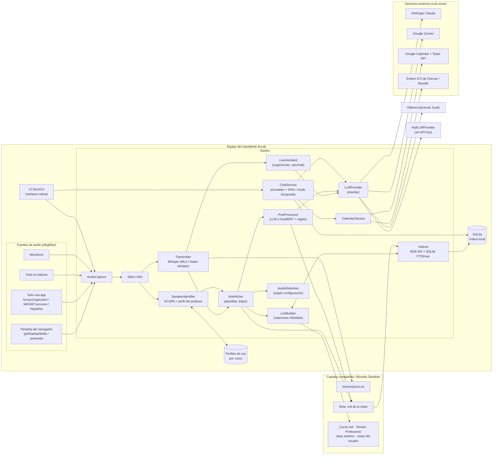
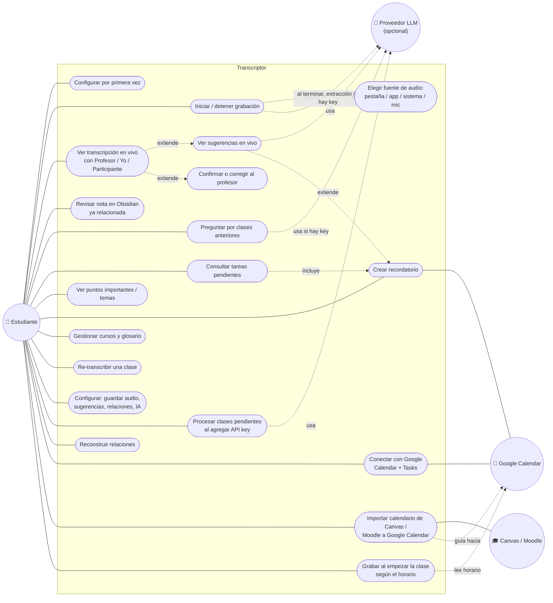
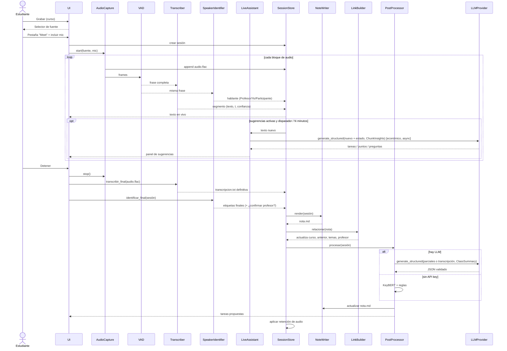
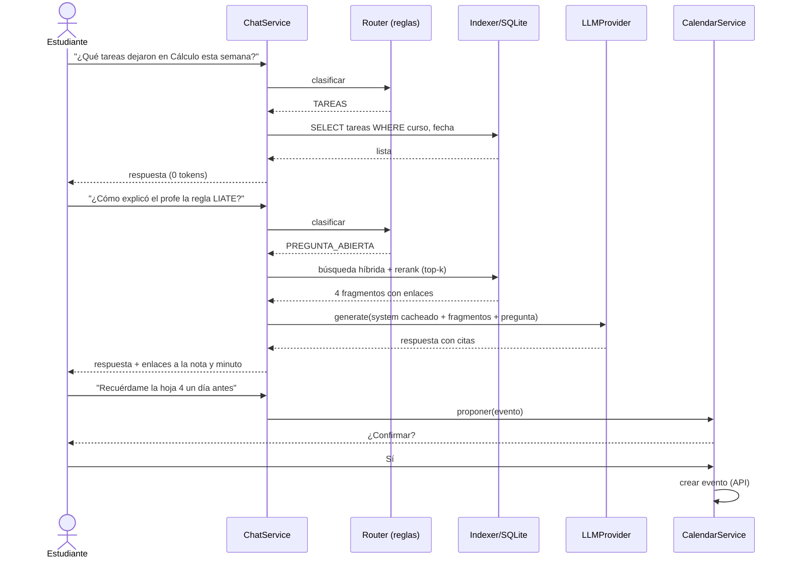
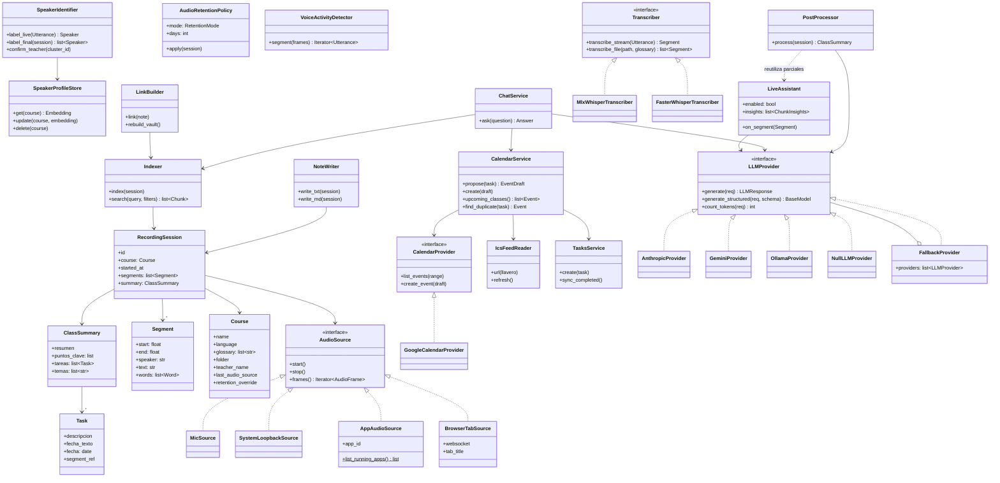

# Plan técnico: Transcriptor de videollamadas para clases

> [!info] Nombre de la app: **Oyente**
> Es el nombre visible y se puede cambiar desde un único archivo (`branding.toml`). Internamente el proyecto sigue identificándose como `transcriptor`, para que un cambio de nombre no afecte los datos de los usuarios (ver [[plan-fases]] §6.5).

> [!summary] Resumen
> Una app de escritorio **local-first** que graba el audio de la videollamada, la **transcribe en vivo**, guarda un `.txt` fiel y genera una nota `.md` lista para **Obsidian** en una carpeta compartida. Un chat permite preguntar por clases anteriores, ver tareas y puntos importantes, y crear recordatorios en **Google Calendar**.
>
> **Regla de oro:** la transcripción la hacen **redes neuronales de voz locales**; el **LLM nunca escribe ni corrige la transcripción**, solo la *lee* para resumir, extraer y responder. Así la fidelidad no depende del LLM y el consumo de tokens es mínimo.
>
> **Sin API key la app sigue siendo útil:** transcribe, identifica al profesor, genera la nota de Obsidian con sus relaciones y permite buscar en clases anteriores. El LLM solo agrega resúmenes, extracción precisa de tareas, chat conversacional y sugerencias en vivo (ver §5.4).

---

## 1. Objetivos y prioridades

| # | Objetivo | Prioridad |
|---|----------|-----------|
| 1 | Transcripción **fiel** (lo que se dijo, tal cual) | 🔴 Máxima |
| 2 | Funciona **100 % local** (sin internet) para transcribir | 🔴 Máxima |
| 3 | Configuración mínima, apta para no programadores | 🟠 Alta |
| 4 | Mínimo consumo de tokens del LLM | 🟠 Alta |
| 5 | Independiente del proveedor de LLM (Claude, Gemini, local) | 🟠 Alta |
| 6 | Escalable a la nube sin reescribir | 🟡 Media |

### Sobre "no puede haber errores"
Ningún modelo de reconocimiento de voz llega a 0 % de error (ruido, acentos, cortes de red de la llamada). Lo que sí podemos garantizar es:

1. **Nunca inventar ni reescribir**: el LLM no toca el texto transcrito.
2. **Doble pasada**: una transcripción en vivo (rápida) + una **pasada final** con el modelo más preciso sobre el audio completo al terminar la clase. La final reemplaza a la de vivo.
3. **Marcar la duda**: palabras con baja confianza se resaltan (`==palabra==`) para revisión rápida en Obsidian.
4. **Conservar el audio** (configurable) para poder volver a escuchar cualquier fragmento por su marca de tiempo.
5. **Glosario por curso** (nombres propios, términos técnicos) que se pasa al modelo de voz para mejorar precisión.
6. **Medir**: un set de prueba con audios reales y su transcripción correcta para medir el WER (tasa de error por palabra) en cada versión.

---

## 2. Lenguaje y stack

### Lenguaje: **Python 3.12**

**Por qué Python:**
- Todo el ecosistema de redes neuronales de voz (Whisper, faster-whisper, MLX, pyannote, Silero VAD, sentence-transformers) es nativo de Python.
- SDKs oficiales de Anthropic (`anthropic`) y Google (`google-genai`) en Python.
- Permite una UI simple sin necesidad de JavaScript.
- Se empaqueta como **instalador de doble clic** para el usuario final (no necesita saber Python).

| Capa | Tecnología | Motivo |
|------|-----------|--------|
| Gestor de entorno | `uv` | Instalación rápida y reproducible |
| UI | **NiceGUI** en modo ventana nativa (`pywebview`) | Interfaz moderna escrita solo en Python |
| Captura de audio | `sounddevice` (mic) + loopback del sistema (ver §6) | Multiplataforma |
| Transcripción | `faster-whisper` (Win/Linux/NVIDIA) · `mlx-whisper` (Mac Apple Silicon) | Mejor relación precisión/velocidad local |
| Detección de voz | Silero VAD | Corta el audio en frases, evita "alucinaciones" en silencios |
| Identificación de hablantes | SpeechBrain **ECAPA-TDNN** (huella de voz) + clustering · pyannote.audio opcional | Siempre activo, identifica al profesor (§6.3) |
| Embeddings | `sentence-transformers` + **BGE-M3** | Multilingüe, muy bueno en español, local |
| Temas sin LLM | **KeyBERT** (sobre BGE-M3) | Palabras clave/temas locales, 0 tokens |
| Coincidencia de nombres | `rapidfuzz` | Unir temas/notas parecidos ("Integral" ≈ "Integrales") |
| Base de búsqueda | **SQLite** + FTS5 + `sqlite-vec` | Un solo archivo, cero configuración, búsqueda híbrida |
| Validación | Pydantic v2 | Esquemas para la salida del LLM |
| Calendario y tareas | Google Calendar API + Google Tasks API (`google-api-python-client`, `google-auth-oauthlib`) | Oficiales |
| Calendarios de la universidad | `icalendar` | Leer enlaces ICS de Canvas/Moodle localmente |
| Configuración | `config.yaml` generado por un **asistente** en la UI | El usuario nunca edita archivos |
| Secretos | `keyring` (llavero del sistema) | API keys fuera de archivos de texto |
| Empaquetado | PyInstaller / Briefcase | `.dmg` / `.exe` |
| Calidad | `ruff`, `mypy`, `pytest` | Estándar |

---

## 3. ¿Dónde se usa IA (LLM), dónde redes neuronales y dónde código normal?

Esta es la decisión más importante para **fidelidad** y **costo de tokens**.

| Funcionalidad | Tipo | Tecnología | ¿Tokens LLM? | Justificación |
|---------------|------|-----------|:---:|---------------|
| Captura de audio | Código | sounddevice / ScreenCaptureKit / WASAPI | ❌ | Determinista |
| Detectar cuándo alguien habla | 🧠 Red neuronal | Silero VAD | ❌ | Pequeña, local, en tiempo real |
| Transcripción en vivo | 🧠 Red neuronal | Whisper large-v3-turbo | ❌ | Local, rápida |
| Transcripción final (alta fidelidad) | 🧠 Red neuronal | Whisper large-v3 (beam search) + alineación por palabra | ❌ | Máxima precisión |
| ¿Quién habla? (Profesor / Yo / Participante) | 🧠 Red neuronal + código | Canales mic/sistema + huella de voz ECAPA + perfil del profesor por curso | ❌ | Ver §6.3 |
| Guardar `.txt` | Código | — | ❌ | Determinista |
| Convertir a `.md` de Obsidian (estructura, frontmatter, marcas de tiempo) | Código | Plantillas Jinja2 | ❌ | **No hace falta IA para dar formato** |
| Resaltar palabras dudosas | Código | Probabilidades del propio Whisper | ❌ | Ya vienen del modelo |
| Resumen, puntos importantes, temas | 🤖 **LLM** | Proveedor configurable | ✅ (1 vez por clase) | Requiere comprensión |
| Extraer tareas y fechas de entrega | 🤖 **LLM** | Salida estructurada (JSON) | ✅ (misma llamada que el resumen) | Requiere comprensión |
| Convertir "el próximo jueves" a fecha | Código | `dateparser` + fecha de la clase | ❌ | Determinista y verificable |
| Indexar clases (y notas de la bóveda) para búsqueda | 🧠 Red neuronal | BGE-M3 embeddings | ❌ | Local |
| Temas cuando **no hay LLM** | 🧠 Red neuronal | KeyBERT | ❌ | Modo sin API key |
| "Posibles tareas" cuando **no hay LLM** | Código | Reglas ("tarea", "entregar", "para el …") + `dateparser` | ❌ | Menos preciso; marcado como "a confirmar" |
| Relacionar la nota nueva con las existentes | Código + 🧠 | Enlaces deterministas + similitud BGE-M3 + `rapidfuzz` | ❌ | Ver §7.3 — **nunca requiere LLM** |
| "¿Qué tareas tengo pendientes?" | Código | Consulta SQL al índice | ❌ | **Ya están extraídas**, no hay que preguntar al LLM |
| "¿Qué vimos de X en la clase del martes?" | 🧠 + 🤖 | Búsqueda híbrida local + LLM con solo los fragmentos relevantes | ✅ (pocos) | RAG |
| Decidir qué tipo de pregunta es | Código primero, LLM pequeño si hay duda | Reglas/palabras clave → modelo barato | ⚠️ mínimo | Ahorro |
| Crear evento en Google Calendar / tarea en Google Tasks | Código | APIs de Google | ❌ | El LLM solo **propone**; el usuario confirma |
| Detectar el inicio de la clase por el horario | Código | Calendar (lectura) | ❌ | Determinista |
| Cruzar tareas con el calendario de Canvas/Moodle | Código | ICS + similitud de títulos (`rapidfuzz`) | ❌ | Determinista |
| Sugerencias en vivo durante la clase | 🤖 LLM (activado si hay API key; se puede apagar) | Modelo barato, disparado por palabras clave o cada N minutos, solo con el texto nuevo | ✅ (incremental) | Ver §6.5; su resultado se **reutiliza** en el resumen final |

> [!important] Consecuencia
> Sin sugerencias en vivo, el LLM se llama **una sola vez** al final de la clase (resumen + tareas + temas en un único JSON). Con sugerencias en vivo, cada llamada procesa solo el bloque nuevo y el cierre solo **une** esos resultados parciales, así que el costo total casi no aumenta. El chat consulta primero el índice local y solo envía al LLM los 3–6 fragmentos relevantes.

---

## 4. Redes neuronales recomendadas

### 4.1 Transcripción (ASR)

| Modelo | Uso | Precisión (español) | Velocidad | Hardware |
|--------|-----|---------------------|-----------|----------|
| **Whisper large-v3-turbo** | En vivo | Muy alta | Rápida | Mac M1+ / GPU NVIDIA 6 GB+ / CPU moderna (con retraso) |
| **Whisper large-v3** | Pasada final | La más alta de Whisper | Media | Igual que arriba; en CPU tarda ~ duración de la clase |
| Whisper medium / small | Equipos modestos | Media-alta | Alta | CPU |
| NVIDIA Canary / Parakeet multilingüe | **Evaluar** como alternativa | Competitiva | Muy rápida en GPU | GPU NVIDIA |

**Motores:**
- Mac Apple Silicon → `mlx-whisper` (usa la GPU/Neural Engine del Mac).
- Windows/Linux con NVIDIA → `faster-whisper` (CTranslate2, `float16`).
- Solo CPU → `faster-whisper` con `int8`.

La app **detecta el hardware automáticamente** y elige motor y modelo. El usuario no elige nada.

**Parámetros para fidelidad:**
- `language="es"` fijo por curso (evita que detecte mal el idioma).
- `beam_size=5`, `temperature=0` en la pasada final.
- `condition_on_previous_text=False` + VAD → reduce alucinaciones y repeticiones.
- `initial_prompt` / hotwords con el **glosario del curso**.
- `word_timestamps=True` → confianza por palabra.
- Interfaz `Transcriber` abstracta para cambiar de modelo sin tocar el resto (y comparar con el benchmark WER).

### 4.2 Otras redes
| Red | Para qué | Notas |
|-----|----------|-------|
| **Silero VAD** | Segmentar por frases, ignorar silencios | ~2 MB, CPU, tiempo real |
| **SpeechBrain ECAPA-TDNN** (`spkrec-ecapa-voxceleb`) | Huella de voz por segmento → identificar al profesor | Por defecto. Local, CPU, **no requiere token** |
| **pyannote 3.x** | Diarización completa (mejor con muchos participantes y voces solapadas) | Mejora opcional; requiere token de Hugging Face → asistente guiado |
| **BGE-M3** | Embeddings para búsqueda semántica y relaciones entre notas | Multilingüe; alternativa: `multilingual-e5-large` |
| **KeyBERT** (sobre BGE-M3) | Temas/palabras clave sin LLM | Reutiliza el mismo modelo de embeddings |
| Cross-encoder reranker (`bge-reranker-v2-m3`) | Reordenar resultados de búsqueda | Opcional, mejora precisión del chat y reduce fragmentos enviados al LLM |

---

## 5. Independencia del proveedor de LLM

### 5.1 Diseño
Una interfaz propia y **delgada** (`LLMProvider`) con adaptadores por proveedor usando **sus SDKs oficiales**. No se usan "shims" de compatibilidad ni librerías intermedias pesadas: menos dependencias, menos sorpresas.

```python
class LLMProvider(Protocol):
    name: str
    def generate(self, req: LLMRequest) -> LLMResponse: ...
    def generate_structured(self, req: LLMRequest, schema: type[BaseModel]) -> BaseModel: ...
    def count_tokens(self, req: LLMRequest) -> int: ...
```

- `LLMRequest`: `system`, `messages`, `max_tokens`, `tier` (`"economico"` | `"estandar"` | `"maximo"`), `cacheable_prefix`.
- Cada adaptador traduce `tier` → modelo concreto según `config.yaml`.
- **Salida estructurada**: todos devuelven JSON validado con Pydantic. Si la validación falla → 1 reintento con el error → si vuelve a fallar → **proveedor de respaldo**.
- **Errores normalizados**: `RateLimit`, `Auth`, `Timeout`, `Refusal`, `InvalidOutput` (cada adaptador mapea los errores tipados de su SDK).

### 5.2 Diferencias que el adaptador debe absorber (para que "no cause errores")

| Tema | Claude (modelos actuales) | Gemini | Local (Ollama) |
|------|---------------------------|--------|----------------|
| JSON garantizado | `output_config.format` (structured outputs) / `messages.parse()` | `response_schema` | `format` JSON schema |
| Prefill del asistente | ❌ No soportado (400) → no usarlo nunca | — | — |
| Forzar herramienta (`tool_choice` any/tool) | ❌ 400 en Opus 5.5 / Sonnet 5.5 → usar salida estructurada | Soportado | Variable |
| Desactivar "thinking" | ❌ No en Opus 5.5 → usar `effort: "low"` | Configurable | N/A |
| Caché de prompt | `cache_control` explícito | Caché implícita / context caching | N/A |
| Rechazo de seguridad | `stop_reason == "refusal"` → manejar y caer a respaldo | `finish_reason` SAFETY | — |
| Lote asíncrono (50 % más barato) | Message Batches API | Batch API | — |

**Contract tests**: una única suite de pruebas que corre contra *todos* los adaptadores (con respuestas grabadas en CI y opcionalmente en vivo). Si un proveedor nuevo pasa la suite, es intercambiable.

### 5.3 Recomendación: ¿solo Claude o multi-proveedor?

**Recomendación: mantener multi-proveedor en el código, pero usar Claude como proveedor por defecto** y Gemini como respaldo automático.

| Tarea | Modelo sugerido (Claude) | Por qué |
|-------|-------------------------|---------|
| Extracción post-clase (resumen + tareas + temas) | `claude-haiku-5-5` (o `claude-sonnet-5-5` si se nota pérdida de detalle) | Muy barato, suficiente para extracción con esquema |
| Chat sobre clases | `claude-sonnet-5-5` | Buen balance calidad/costo |
| Calidad máxima (opcional) | `claude-opus-5-5` | Para quien prefiera calidad sobre costo |
| Clasificar la pregunta (si las reglas no bastan) | `claude-haiku-5-5` | Respuesta corta, mínimo costo |

**Por qué Claude por defecto:** muy buena comprensión del español académico, salida estructurada estricta, caché de prompt con control explícito y Batch API, lo que encaja con el objetivo de pocos tokens.
**Por qué no *solo* Claude:** respaldo ante caídas o límites, el usuario puede ya tener créditos de Google, y Gemini también es fuerte en contextos largos. El costo de mantener la abstracción es bajo porque el LLM solo hace 2–3 tipos de tareas.
**Opción 100 % offline:** adaptador Ollama con un modelo local (calidad menor, costo cero).

> Los nombres de modelo viven en `config.yaml`, no en el código: cambiar de modelo no requiere nueva versión.

### 5.4 Funcionamiento sin API key (modo "Solo local")

El LLM es una **mejora**, no un requisito. Si no hay API key configurada (o el proveedor falla, no hay internet o se alcanzó el límite de gasto), la app usa `NullLLMProvider` y degrada con elegancia, **sin errores ni pantallas bloqueadas**.

| Función | Con API key | Sin API key |
|---------|-------------|-------------|
| Transcripción en vivo + pasada final | ✅ | ✅ (idéntica) |
| Identificar al profesor | ✅ | ✅ (idéntica) |
| `.txt` y nota `.md` de Obsidian | ✅ | ✅ |
| Relaciones con otras notas (§7.3) | ✅ | ✅ (idénticas) |
| Temas | LLM | KeyBERT local |
| Tareas | Extracción precisa por LLM | "Posibles tareas" por reglas, marcadas *a confirmar* |
| Resumen | LLM | ❌ (sección "Resumen pendiente") |
| Chat | Respuesta redactada con citas | **Modo búsqueda**: muestra los fragmentos más relevantes con enlace al minuto |
| Recordatorios en Calendar | Propuestos automáticamente | Manual: botón "Crear recordatorio" junto a cada tarea |
| Sugerencias en vivo | ✅ | ❌ (panel oculto) |

- Cada sesión guarda `llm_procesado: false` en su frontmatter. Cuando el usuario agrega una API key, la app ofrece **"Procesar clases pendientes"** (con Batch API para que sea más barato).
- La interfaz muestra un indicador discreto "Modo local" y nunca bloquea la grabación por temas del LLM.
- La opción **Ollama** permite tener resúmenes y chat sin API key, 100 % offline, si el equipo es suficiente.

---

## 6. Captura de audio y transcripción en vivo

### 6.1 Fuentes de audio (elegibles al iniciar cada grabación)

Se capturan **dos canales separados**:
1. **Canal de la clase**: lo que se oye de la llamada (profesor y compañeros). El usuario **elige de dónde sale**.
2. **Micrófono** (tu voz): casilla "Incluir mi micrófono" (activada por defecto) con selector de dispositivo.

Al pulsar **Grabar** aparece el selector de fuente, que recuerda la última opción usada por curso:

| Opción | Qué captura | macOS | Windows | Linux | Notas |
|--------|-------------|-------|---------|-------|-------|
| 🗂️ **Una pestaña del navegador** | Solo el audio de esa pestaña (p. ej. la de Meet) | Chrome / Edge | Chrome / Edge | Chrome / Edge | Ver §6.1.1. Firefox y Safari no permiten capturar el audio de una pestaña |
| 🌐 **Solo una aplicación** (p. ej. "Google Chrome", "Zoom", "Teams") | Todo el audio de esa app, nada más | ScreenCaptureKit con filtro por aplicación (macOS 13+) | *Process loopback* de WASAPI (Windows 10 2004+ / 11) | Flujo de PipeWire de esa app | Lista de apps que están sonando en ese momento |
| 🔊 **Todo el sistema** | Todo lo que suena en el equipo | ScreenCaptureKit · alternativa BlackHole | WASAPI loopback | PipeWire/Pulse *monitor* | La opción más compatible; también capta notificaciones, música, etc. |
| 🎙️ **Solo micrófono** | Clase presencial o grabadora externa | ✅ | ✅ | ✅ | Útil para clases en el aula |

- "Solo el navegador" = opción **Solo una aplicación** eligiendo Chrome/Edge/Firefox/Safari. Funciona con **cualquier** navegador.
- "Solo una pestaña" es lo más limpio (no se cuela música de otra pestaña), pero solo en navegadores Chromium.
- Las tres opciones de captura del equipo comparten la interfaz `AudioSource`: el resto del pipeline no sabe de dónde viene el audio.
- Si la fuente elegida deja de estar disponible (se cerró la pestaña o la app), la grabación **no se pierde**: se pausa el canal, se avisa y se ofrece cambiar de fuente sin cortar la sesión.

#### 6.1.1 Captura de una pestaña del navegador

**Fase 1, sin instalar nada:** la app abre una página local (`http://localhost:<puerto>/captura`) en Chrome/Edge con un botón **"Elegir pestaña"**. Ese botón usa `getDisplayMedia()`, que muestra el selector nativo de Chrome. El usuario elige la pestaña de la clase y deja marcada la casilla *"Compartir audio de la pestaña"*. El audio se convierte a PCM 16 kHz (AudioWorklet) y se envía a la app por WebSocket local. La pista de video que exige la API se descarta de inmediato.

**Fase 2, comodidad:** una **extensión de Chrome/Edge** (API `chrome.tabCapture`) con un botón "Transcribir esta pestaña" en la barra del navegador y una lista de pestañas desde la propia app. Se comunica con la app por WebSocket local, y el audio nunca sale del equipo.

**La extensión es solo una recomendación y se instala manualmente:**
- **Por defecto se usa la captura por aplicación** ("Solo una aplicación → tu navegador" o la app de la llamada). No requiere extensión y funciona con cualquier navegador.
- La extensión **solo se sugiere** cuando el usuario elige "Una pestaña del navegador". Aun sin ella, la captura por pestaña funciona con el método de la Fase 1, con un paso más.
- **Detección:** la extensión se anuncia a la app por el WebSocket local. Si ya está instalada, no se vuelve a sugerir. Si no está, aparece un aviso no bloqueante: *"Para capturar pestañas con un clic, instala la extensión (opcional)"*, con los botones **Instalar** / **Ahora no** / **No volver a mostrar**.
- **Instalación manual guiada** (no se publica en la Chrome Web Store):
  1. La carpeta de la extensión viene **incluida en el instalador** de la app.
  2. El botón "Instalar" abre `chrome://extensions` (o `edge://extensions`) y la carpeta de la extensión en el explorador de archivos.
  3. Una guía con capturas muestra los pasos: activar *Modo de desarrollador* → *Cargar descomprimida* → elegir la carpeta.
  4. La app confirma "Extensión conectada ✔" en cuanto la detecta.
- Las actualizaciones de la extensión llegan con cada versión de la app; si hay una versión nueva, la app lo indica y repite la guía.

> [!note] Recomendación por defecto
> El asistente sugiere **"Solo una aplicación → tu navegador"** (o la app de la llamada) porque funciona en todos los navegadores sin pasos extra. "Una pestaña" (y con ella la recomendación de instalar la extensión) se ofrece solo cuando se detecta Chrome/Edge y el usuario la elige.

### 6.2 Pipeline en vivo
1. Buffer de audio 16 kHz mono por canal → se guarda en `audio.flac` (sin pérdida). Siempre se graba durante la sesión porque la pasada final lo necesita; **qué pasa después lo decide el usuario** (§6.4).
2. Silero VAD corta frases (0,5–30 s).
3. Cada frase va a la cola del transcriptor (hilo aparte).
4. El texto se **añade** al `.txt` en cuanto sale (escritura con `flush`), así no se pierde nada si la app se cierra.
5. La UI muestra el texto en vivo.

### 6.3 Quién habla: identificación del profesor (siempre activa)

**Objetivo:** cada segmento queda etiquetado como **Profesor**, **Yo** o **Participante**. Distinguir entre participantes ("Participante 1, 2…") es un extra, no una prioridad.

| Paso | Cómo | IA |
|------|------|----|
| 1. Yo vs. clase | Canal micrófono = **Yo**; canal de la clase = el resto | Ninguna (separación por canal) |
| 2. Huella de voz | Cada frase del canal de la clase → *embedding* de voz con **ECAPA-TDNN** (local, CPU, ~20 ms por frase) | 🧠 Red neuronal |
| 3. Perfil del profesor | Cada curso guarda la **huella promedio del profesor** (`perfiles/<curso>.npy`, solo números, no audio) | Código |
| 4. En vivo | Similitud coseno con el perfil: ≥ umbral → **Profesor**; si no → **Participante** | Código |
| 5. Pasada final | Clustering de todas las huellas de la clase: el grupo que coincide con el perfil (o, si no hay perfil, **el que más tiempo habla**) = Profesor; los demás grupos = Participante 1, 2… | Código + 🧠 |
| 6. Aprendizaje | El perfil se actualiza con cada clase (media móvil) y mejora con el tiempo | Código |

**Primera clase de un curso (sin perfil todavía):** se asume que el profesor es quien más habla en el canal de la clase, lo cual suele acertar. Al terminar, la app muestra *"¿Este es el profesor?"* con un fragmento de 5 s para escuchar y botones **Sí / No, es este otro**. Basta una confirmación por curso.

**Corrección manual:** en la vista de la sesión, clic en una etiqueta → "Esto lo dijo el profesor". La corrección actualiza el perfil.

**Mejora opcional:** si el usuario configura un token de Hugging Face, se usa **pyannote** para la segmentación (mejor con voces solapadas). El paso 3 de perfiles se mantiene igual.

> [!note] Privacidad
> El perfil de voz es un vector numérico local que no permite reconstruir la voz. Se puede borrar desde Configuración → Cursos.

### 6.4 Al terminar la clase
1. Pasada final con Whisper large-v3 sobre `audio.flac` completo → `transcripcion.txt` definitivo (el de vivo se conserva como `.live.txt` hasta validar).
2. Identificación final de hablantes (§6.3, paso 5).
3. Generación del `.md` (código, sin IA).
4. **Relaciones con otras notas** (§7.3, sin IA).
5. Si hay LLM: **una** llamada que une los resultados parciales de las sugerencias en vivo (o procesa toda la clase si estaban apagadas) → JSON con resumen, puntos clave, tareas, temas y fechas. Si no hay LLM: KeyBERT + reglas (§5.4).
6. Se completa el `.md` y se indexa en SQLite.
7. Si hay tareas con fecha → la app **propone** recordatorios y el usuario confirma.
8. **Audio según la configuración del usuario:**

| Ajuste (Configuración → Audio → "Guardar audio de las clases") | Comportamiento |
|---|---|
| **Siempre** | Se conserva el audio en el formato elegido (ver abajo) |
| **Durante N días** (por defecto 30) | Se borra automáticamente al cumplir N días |
| **Nunca** | Se borra en cuanto termina la pasada final con éxito; si la pasada falla, se conserva hasta reintentar para no perder la clase |

   - El ajuste es global, con opción de **sobrescribirlo por curso**.
   - En la vista de la sesión hay un botón "Conservar este audio" o "Borrar ahora".
   - Sin audio, los enlaces de tiempo siguen funcionando para leer, pero no para reproducir.
   - Ubicación del audio: dentro de la carpeta compartida (si se quiere en todos los dispositivos) o **solo en este equipo** (por defecto, para no saturar la nube).

**Formato del audio guardado: lo elige el usuario** (Configuración → Audio → "Formato"). Junto a cada opción se muestra cuánto ocupa:

| Formato | Calidad | Por canal | Clase con micrófono (2 canales) | Clase de 1,5 h con micrófono |
|---------|---------|-----------|----------------------------------|------------------------------|
| **FLAC** | Sin pérdida (idéntico a lo grabado); sirve para re-transcribir con la máxima fidelidad | ≈ 60 MB/h | ≈ 120 MB/h | ≈ 180 MB |
| **Opus 24 kbps** | Muy buena para voz; suficiente para reescuchar y re-transcribir con precisión prácticamente igual | ≈ 11 MB/h | ≈ 22 MB/h | ≈ 33 MB |

- La interfaz muestra la estimación en vivo según el formato y la retención elegidos. Por ejemplo: *"Con FLAC y 'Durante 30 días', tus 4 cursos ocuparán ≈ 5,8 GB"* (calculado con el horario de los cursos). En la pantalla de grabación se ve el tamaño acumulado de la sesión.
- **Durante la clase siempre se graba en FLAC** temporal, porque la pasada final de transcripción usa el audio sin pérdida. Al terminar, si el usuario eligió Opus, se convierte y se borra el FLAC temporal.
- El formato se puede sobrescribir **por curso**. Cambiarlo no convierte los audios ya guardados, aunque hay un botón "Convertir audios existentes a Opus" para liberar espacio.
- Las cifras son estimadas (audio 16 kHz mono por canal) y se recalculan con el tamaño real de las sesiones guardadas.

### 6.5 Sugerencias del LLM en vivo

**Activadas por defecto si hay API key**; se apagan en Configuración → IA → "Sugerencias durante la clase", o desde un interruptor en la pantalla de grabación.

**Qué muestran** (panel lateral, nunca dentro de la transcripción):
- 📌 Posibles **tareas** y fechas detectadas ("Entregar hoja 4 → jueves 19/10"), con botón "Agregar recordatorio".
- ⭐ **Puntos importantes** ("El profe dijo que esto viene en el examen").
- ❓ **Preguntas sugeridas** para hacer en clase si algo quedó confuso.
- 🔗 **Clases relacionadas** (búsqueda local, sin tokens): "Esto se vio también el 05/10".

**Diseño de bajo consumo:**
1. **Disparadores locales** (sin tokens): palabras como *tarea, entregar, examen, parcial, importante, para el próximo, no olviden* → llamada inmediata con el bloque reciente.
2. **Intervalo**: si no hubo disparadores, una llamada cada **N minutos** (por defecto 10, configurable 5–30).
3. Solo se envía el **texto nuevo** desde la última llamada más un "estado" muy corto (temas y tareas ya detectados). El prompt de sistema y el esquema son fijos y van con **caché de prompt**.
4. Se usa siempre el **modelo económico** (`tier="economico"`).
5. **Tope por clase** (por ejemplo, máximo 12 llamadas o X tokens). Al alcanzarlo, se pausan las sugerencias y se avisa.
6. Cada respuesta es JSON parcial (`ChunkInsights`). Al cerrar la clase, el resumen final **une** esos parciales (*map-reduce*) en lugar de reenviar la transcripción completa, por lo que el costo total es similar al de no tener sugerencias.
7. Si el LLM falla en vivo, el panel muestra "Sugerencias no disponibles" y **la transcripción continúa sin interrupción**. Las llamadas son asíncronas y nunca bloquean el hilo de audio.

---

## 7. Formato de salida (Obsidian)

### 7.1 Carpeta compartida
El usuario elige una carpeta (Google Drive, OneDrive, Dropbox, iCloud o Syncthing) que **es su bóveda de Obsidian** o está dentro de ella.

```
<Bóveda>/
├── Clases/
│   ├── _Índice.md                      # generado: cursos, últimas clases, tareas pendientes
│   ├── Cálculo II/
│   │   ├── _Curso.md                   # MOC del curso: profesor, horario, glosario, lista de clases
│   │   ├── 2026-10-05 Integrales definidas.md
│   │   ├── 2026-10-12 Integrales por partes.md
│   │   └── .transcriptor/
│   │       └── 2026-10-12/
│   │           ├── transcripcion.txt   # fuente de verdad
│   │           ├── segmentos.json      # tiempos, hablante, confianza
│   │           └── audio.flac          # según configuración (§6.4)
│   └── Física I/
├── Profesores/
│   └── Ing. Pérez.md                   # cursos que imparte, clases
└── Temas/
    ├── Integración por partes.md       # nota de concepto, enlaza a todas las clases donde aparece
    └── Regla LIATE.md
```

- Las carpetas `Profesores/` y `Temas/` son configurables. Si el usuario ya tiene su propia carpeta de conceptos, se usa esa.
- La base SQLite **no** va en la carpeta compartida (evita corrupción por sincronización); se reconstruye desde los `.md`/`.txt` si hace falta.
- Escrituras atómicas (archivo temporal + renombrar) para no romper la sincronización.

### 7.2 Plantilla de nota
```markdown
---
tipo: clase
curso: "[[Cálculo II/_Curso|Cálculo II]]"
fecha: 2026-10-12
hora_inicio: "18:00"
duracion_min: 92
profesor: "[[Ing. Pérez]]"
fuente_audio: "pestaña: meet.google.com"
anterior: "[[2026-10-05 Integrales definidas]]"
siguiente:
temas: ["[[Integración por partes]]", "[[Regla LIATE]]"]
relacionadas: ["[[2026-10-05 Integrales definidas]]", "[[Física I/2026-10-08 Trabajo y energía]]"]
tareas_pendientes: 2
modelo_asr: whisper-large-v3
llm_procesado: true
revisado: false
aliases: ["Cálculo II 2026-10-12"]
tags: [clase, calculo-ii]
---

# Integrales por partes — 2026-10-12

← [[2026-10-05 Integrales definidas|Clase anterior]] · [[Cálculo II/_Curso|Curso]] · Clase siguiente →

> [!summary] Resumen
> ...

## Puntos importantes
- La regla [[Regla LIATE|LIATE]] ordena qué elegir como *u*… ([[#^t-00-14-32|14:32]])

## Tareas
- [ ] Hoja de ejercicios 4, problemas 1–10 📅 2026-10-19 #tarea
- [ ] Leer capítulo 7 📅 2026-10-15 #tarea

## Temas de interés
- [[Integración por partes]]
- [[Regla LIATE]]

## Relacionado
%% transcriptor:relacionado:inicio %%
- [[2026-10-05 Integrales definidas]] — misma unidad (similitud 0.82)
- [[Física I/2026-10-08 Trabajo y energía]] — también usa integrales definidas
- [[Mis apuntes de derivadas]] — nota tuya mencionada en clase
%% transcriptor:relacionado:fin %%

## Transcripción
**[00:14:32] Profesor:** Entonces la regla LIATE nos dice que... ^t-00-14-32
**[00:15:10] Yo:** ¿Eso aplica también para ==logaritmos== compuestos? ^t-00-15-10
**[00:15:40] Participante 1:** ¿Y si hay dos funciones trigonométricas? ^t-00-15-40
```

- Tareas en formato compatible con el plugin **Tasks** de Obsidian.
- Bloques `^id` por segmento: los puntos importantes enlazan al momento exacto.
- `==resaltado==` = baja confianza, revisar.
- La transcripción **no se modifica con enlaces** (fidelidad y legibilidad): los enlaces van en resumen, puntos, temas y la sección "Relacionado".
- Propiedades compatibles con **Dataview** y con la vista de *Properties* / *Bases* de Obsidian.

### 7.3 Relaciones automáticas con las notas existentes

Al crear la nota nueva, el `LinkBuilder` la conecta con la bóveda **sin LLM** (funciona igual en modo sin API key):

| Relación | Cómo se detecta | Dónde se escribe |
|----------|-----------------|------------------|
| **Curso** | Curso elegido al grabar | `curso:` + se agrega a la lista de clases en `_Curso.md` |
| **Anterior / siguiente** | Clase previa del mismo curso por fecha | `anterior:` en la nueva y **se actualiza `siguiente:`** en la anterior |
| **Profesor** | Perfil del curso | `profesor:`; se crea o actualiza `Profesores/<nombre>.md` |
| **Temas** | Temas del LLM o KeyBERT → **normalizados** contra notas de tema existentes (similitud BGE-M3 + `rapidfuzz` + `aliases`) para reutilizar "Integración por partes" en vez de crear "Integracion x partes" | `temas:` + sección de la nota; se crea la nota de tema si no existe, o se agrega la clase a su lista |
| **Clases relacionadas** | Similitud semántica (BGE-M3) del resumen/temas con otras clases (cualquier curso), top 3–5 por encima de un umbral | `relacionadas:` + sección "Relacionado" |
| **Notas propias del usuario** | Títulos y `aliases` de notas existentes en la bóveda que aparecen mencionados en la clase (como las *menciones no enlazadas* de Obsidian), más similitud semántica | Sección "Relacionado" |
| **Tareas** | Tareas extraídas | `_Índice.md` (con consulta del plugin Tasks) y `tareas_pendientes:` |

**Bidireccional:** Obsidian ya muestra los *backlinks*, pero además se actualizan las notas destino (tema, curso, profesor y clase anterior) para que la relación se vea en ambos lados y en el grafo.

**Reglas de seguridad para no romper la bóveda del usuario:**
1. La app **solo edita**:
   - sus propias notas,
   - las propiedades del frontmatter que le pertenecen (`anterior`, `siguiente`, `relacionadas`, `temas`, `tareas_pendientes`),
   - lo que está entre marcadores `%% transcriptor:…:inicio %%` / `%% …:fin %%` (comentarios invisibles en Obsidian).
2. **Nunca** modifica texto escrito por el usuario. En notas del usuario solo **lee**: se enlaza *desde* la nota nueva hacia ellas.
3. Escritura atómica y comparación de la fecha de modificación antes de guardar. Si el archivo cambió mientras tanto (por ejemplo, el usuario lo tiene abierto), se reintenta sin pisar sus cambios.
4. Respeta renombres: busca notas por `aliases` y por un id estable (`transcriptor_id`) en el frontmatter, no solo por nombre de archivo.
5. Configuración → Obsidian: activar o desactivar cada tipo de relación, ajustar el umbral de similitud y elegir las carpetas a **excluir** del análisis (p. ej. `Diario/`, `Privado/`).
6. Botón **"Reconstruir relaciones"** para recalcular toda la bóveda (útil al instalar por primera vez con clases ya existentes).

**Indexado de la bóveda:** las notas del usuario se indexan localmente (embeddings + FTS) solo para relaciones y búsqueda. Un vigilante de archivos (`watchdog`) mantiene el índice al día de forma incremental.

---

## 8. Chat y ahorro de tokens

### 8.1 Flujo de una pregunta
1. **Enrutador por reglas** (sin LLM): "tareas", "pendiente", "para cuándo" → consulta SQL directa. "recordatorio", "agenda" → flujo de calendario.
2. Si no aplica una regla → **búsqueda híbrida local** (FTS5 palabras exactas + vectores BGE-M3) filtrada por curso/fecha si se mencionan.
3. Primero se buscan en los **resúmenes** (cortos); solo si no alcanza se bajan a fragmentos de transcripción.
4. Reranker → top 3–6 fragmentos (~1.500–3.000 tokens).
5. LLM responde **citando** la clase y el minuto (enlace a la nota).

### 8.2 Técnicas de ahorro
| Técnica | Ahorro estimado |
|---------|-----------------|
| Transcribir localmente (sin API de voz) | 100 % del costo de transcripción |
| Formato `.md` por código | 100 % |
| Una sola llamada estructurada por clase | vs. varias llamadas separadas |
| Tareas/temas pre-extraídos → respuestas por SQL | Muchas preguntas a 0 tokens |
| RAG con top-k pequeño + resúmenes primero | Se envía < 5 % de la transcripción |
| Caché de prompt (system prompt y esquema fijos) | Lecturas de caché mucho más baratas |
| Batch API para el post-proceso (si no hay prisa) | ~50 % |
| Modelo barato para extracción, intermedio para chat | Escalado por tarea |
| Historial de chat recortado (últimos N turnos + resumen) | Evita crecimiento lineal |
| `count_tokens` antes de enviar + límite configurable por mes | Control de gasto |

Para clases muy largas (> ~2 h) el post-proceso divide en bloques, extrae por bloque con el modelo barato y luego une (map-reduce), en lugar de enviar todo a un modelo caro.

---

## 9. Integración con Google (Calendar + Tasks) y calendarios de la universidad

### 9.1 Principios
- **No hay "login" para usar la app.** La app es local y no tiene cuentas. Google se conecta desde un botón opcional, **"Conectar con Google"**, en el asistente o en Configuración → Google.
- **Autorización incremental:** cada función pide **solo su permiso** cuando el usuario la activa. Si nunca activa Tasks, nunca se pide el permiso de Tasks.
- **Todo es opcional:** sin Google, los recordatorios se pueden exportar como archivo `.ics` y la app sigue funcionando completa.
- OAuth de escritorio (flujo *loopback* con PKCE); tokens guardados en el **llavero del sistema**; botón "Desconectar" que revoca el token.

### 9.2 Alcance de la v1

| Función | Qué hace | Permiso (scope) | Nivel en Google |
|---------|----------|-----------------|-----------------|
| **Leer el horario** | Detecta cuándo empieza cada clase: aviso *"Cálculo II empieza en 5 min. ¿Grabar?"*, curso preseleccionado e inicio/fin automático opcional. Toma título y asistentes del evento (p. ej. el profesor) para la nota. También lee los eventos de Canvas si el usuario se suscribió (§9.4) | `calendar.events.readonly` + `calendar.calendarlist.readonly` | Sensible |
| **Crear recordatorios** | Crea los eventos en un calendario propio, **"Clases – Transcriptor"**, que se puede ocultar, colorear o borrar sin tocar los demás calendarios | `calendar.app.created` | Sensible (no da acceso a escribir en otros calendarios) |
| **Tareas en Google Tasks** | Cada tarea de clase va a una lista **"Tareas de clase"** con fecha de entrega y un enlace a la nota de Obsidian (`obsidian://open?...`). Se ve en Calendar, Gmail y el celular | `tasks` | Sensible |

**Fuera de la v1:** Google Classroom (opcional, más adelante), enviar el resumen por correo (opcional, más adelante) y leer Gmail (no recomendado: permiso restringido con auditoría anual de pago; a lo sumo como función experimental).

### 9.3 Flujo de recordatorios y tareas
1. El LLM (o las reglas en modo sin API key) devuelve `{titulo, fecha_texto, descripcion}`.
2. El **código** resuelve la fecha con `dateparser` relativo a la fecha de la clase.
3. Tarjeta de confirmación: **"Agregar como: ☐ Tarea (Google Tasks) ☐ Recordatorio (Calendar)"**. Por defecto, una tarea con fecha de entrega se agrega a Tasks y un examen o evento con hora se agrega a Calendar. La antelación del recordatorio es configurable (p. ej. 1 día antes).
4. Solo al confirmar se llama a la API. Existe la opción "Agregar automáticamente sin preguntar" (desactivada por defecto).
5. **Sin duplicados:** id determinista (hash de curso + tarea + fecha) en `extendedProperties` (Calendar) y en las notas de la tarea (Tasks).
6. **Cruce con Canvas** (§9.4): si la tarea ya existe en el calendario de la universidad, se muestra *"Ya está en Canvas con fecha 19/10"* y no se duplica. Si las fechas no coinciden, se avisa: *"El profesor dijo jueves 17, Canvas dice 19"*.
7. **Sincronización de vuelta:** si el usuario marca la tarea como completada en Google Tasks, la casilla `- [x]` se actualiza en Obsidian (consulta periódica, sin tokens).

### 9.4 Recomendación: importar el calendario de actividades de la universidad (Canvas, Moodle, Blackboard…)

La mayoría de plataformas académicas publican un **enlace de calendario (iCal/ICS)** con las entregas y exámenes. La app **recomienda** importarlo a Google Calendar, porque así:
- Todas las fechas oficiales aparecen junto a los recordatorios de clase.
- La app puede **cruzar** lo que dijo el profesor con lo publicado oficialmente (§9.3, paso 6).
- La app detecta mejor el horario de clases.

**Cuándo se muestra la recomendación:** una tarjeta no bloqueante en la pantalla de inicio y en Configuración → Google. Aparece al conectar Google o al crear el primer curso, y desaparece si se detecta un calendario suscrito con origen ICS o si el usuario pulsa "No volver a mostrar".

> [!tip] ¿Usas Canvas? Importa tu calendario de actividades a Google Calendar
> Así verás todas tus entregas y la app podrá avisarte si algo no coincide con lo que dijo el profesor.
> **[Ver cómo hacerlo]** · **[Ya lo hice]** · **[Ahora no]**

**Guía paso a paso** (con capturas y selector de plataforma):

| Plataforma | Dónde está el enlace |
|------------|----------------------|
| **Canvas** | Calendario → botón **"Fuente de calendario" / "Calendar Feed"** → copiar enlace |
| **Moodle** | Calendario → **Exportar calendario** → "Todos los cursos" → **Obtener URL del calendario** |
| **Blackboard** | Calendario → ⚙️ → **Compartir calendario** → copiar enlace |
| Otra | Buscar "iCal", "ICS" o "Exportar/Suscribirse" en el calendario de la plataforma |

Luego, en Google Calendar: **Otros calendarios → + → Desde URL → pegar enlace**. La app abre esa página directamente (`calendar.google.com/calendar/r/settings/addbyurl`) y copia el enlace al portapapeles.

**Notas técnicas:**
- La API de Google Calendar **no permite** suscribirse a un enlace ICS, así que este paso lo hace el usuario con la guía (2 clics). Google refresca estas suscripciones cada varias horas, no en tiempo real.
- **Alternativa sin Google:** el usuario pega el enlace ICS en Configuración → Calendarios de la universidad, y la app lo **lee localmente** (librería `icalendar`, refresco cada pocas horas) para el cruce de fechas y para crear tareas en Tasks desde las entregas de Canvas. El enlace ICS es privado (contiene un token): se guarda en el llavero y nunca se escribe en la bóveda.
- Opcional: **"Crear tareas en Google Tasks desde Canvas"** para que las entregas oficiales también aparezcan como tareas (desactivado por defecto, con deduplicación).

### 9.5 Verificación de Google (requisito para distribuir)
- En modo **"Prueba"** el proyecto de Google admite hasta 100 usuarios, pero **los tokens caducan cada 7 días** y obligan a reconectar. Sirve solo durante el desarrollo.
- Para distribuir, hay que **publicar y verificar** la app OAuth: pantalla de consentimiento, política de privacidad, dominio y video demostrativo. Calendar y Tasks son permisos *sensibles*: requieren verificación, pero **no** la auditoría de seguridad de pago que exigen los permisos *restringidos* como Gmail.
- Las credenciales OAuth del cliente de escritorio se incluyen en la app (es lo estándar para apps instaladas; con PKCE no se expone nada sensible).
- **Futuro:** el mismo `CalendarProvider` permite agregar Microsoft (Outlook Calendar + To Do) para universidades con Office 365.

## 10. Diagramas

### 10.1 Arquitectura


> El **audio nunca sale del equipo**. A la nube solo viajan fragmentos de texto al LLM, y solo si hay API key.

### 10.2 Casos de uso


### 10.3 Flujo general

```mermaid
flowchart TD
  A([Inicio]) --> B{¿Primera vez?}
  B -- Sí --> C[Asistente: carpeta, cursos,<br/>IA opcional, Google opcional]
  B -- No --> D
  C --> D[Elegir curso y pulsar Grabar]
  D --> D2[Elegir fuente: pestaña / app /<br/>sistema / solo mic + incluir mic]
  D2 --> E[Capturar canales]
  E --> F[VAD corta frases]
  F --> G[Whisper turbo transcribe]
  F --> G2[ECAPA: ¿Profesor / Participante?]
  G --> H[Agregar a .txt y mostrar en UI]
  G2 --> H
  H --> SG{¿Sugerencias activas<br/>y hay API key?}
  SG -- Sí --> SG2{¿Disparador o<br/>pasaron N min?}
  SG2 -- Sí --> SG3[LLM económico con texto nuevo<br/>→ panel de sugerencias]
  SG2 -- No --> I
  SG3 --> I
  SG -- No --> I
  I{¿Detener?}
  I -- No --> E
  I -- Sí --> J[Pasada final Whisper large-v3<br/>+ clustering de hablantes]
  J --> J2{¿Perfil del profesor<br/>existe?}
  J2 -- No --> J3[Asumir el que más habla<br/>y pedir confirmación]
  J2 -- Sí --> K
  J3 --> K[Generar .md por plantilla]
  K --> LB[LinkBuilder: curso, anterior/siguiente,<br/>profesor, temas, relacionadas]
  LB --> L{¿LLM configurado y disponible?}
  L -- Sí --> M[1 llamada: unir parciales →<br/>resumen + tareas + temas JSON]
  M --> N{¿JSON válido?}
  N -- No --> O[Reintento / proveedor de respaldo]
  O --> N
  N -- Sí --> P[Completar .md]
  L -- No --> Q[KeyBERT + reglas:<br/>temas y posibles tareas;<br/>llm_procesado: false]
  P --> R[Indexar en SQLite]
  Q --> R
  R --> AU{Ajuste 'Guardar audio'}
  AU -- Siempre --> S
  AU -- N días --> AU2[Programar borrado] --> S
  AU -- Nunca --> AU3[Borrar audio.flac] --> S
  S{¿Hay tareas con fecha?}
  S -- Sí --> T[Proponer recordatorios]
  T --> U{¿Usuario confirma?}
  U -- Sí --> V[Crear evento en Calendar]
  U -- No --> W([Fin])
  S -- No --> W
  V --> W
```


### 10.4 Secuencia: grabación en vivo y cierre


### 10.5 Secuencia: pregunta en el chat


### 10.6 Diagrama de clases


---

## 11. Estructura del proyecto

```
transcriptor/
├── pyproject.toml
├── uv.lock
├── README.md
├── docs/
│   ├── plan/plan-transcriptor.md
│   └── usuario/                 # guía para no programadores (con capturas)
├── src/transcriptor/
│   ├── app.py                   # entrada, UI
│   ├── ui/                      # pantallas: grabar, chat, cursos, asistente
│   ├── audio/                   # fuentes (mic, sistema, app, pestaña), VAD, retención
│   ├── capture_web/             # página local de captura de pestaña (getDisplayMedia + AudioWorklet)
│   ├── asr/                     # Transcriber + motores + detección de hardware
│   ├── speakers/                # SpeakerIdentifier, perfiles de voz por curso
│   ├── notes/                   # NoteWriter + plantillas Jinja2
│   ├── links/                   # LinkBuilder, normalización de temas, vigilante de bóveda
│   ├── llm/                     # LLMProvider, adaptadores (Claude, Gemini, Ollama, Null), esquemas, prompts
│   ├── live/                    # LiveAssistant (sugerencias en vivo)
│   ├── processing/              # PostProcessor (LLM o KeyBERT + reglas)
│   ├── search/                  # Indexer, embeddings, SQLite
│   ├── chat/                    # Router, ChatService
│   ├── calendar/                # CalendarService
│   └── config/                  # modelos de config, keyring
├── tests/
│   ├── unit/
│   ├── contract/                # misma suite para cada LLMProvider
│   ├── fixtures/                # respuestas grabadas, audios cortos
│   └── benchmark/               # medición de WER
├── browser-extension/           # Fase 2: extensión Chrome/Edge (tabCapture)
└── packaging/                   # PyInstaller / Briefcase
```

---

## 12. Git

- **Repositorio**: GitHub (privado al inicio).
- **Ramas**: *trunk-based* — `main` siempre estable; ramas cortas `feat/…`, `fix/…`, `docs/…`; merge por Pull Request.
- **Commits**: Conventional Commits (`feat: captura de audio en Windows`, `fix(asr): …`).
- **Versionado**: SemVer (`v0.1.0`), etiquetas → GitHub Release con instaladores adjuntos.
- **CI (GitHub Actions)**: `ruff`, `mypy`, `pytest` (unit + contract con respuestas grabadas) en macOS y Windows; build de instaladores al crear etiqueta.
- **pre-commit**: ruff, formato, detección de secretos (`gitleaks`).
- **`.gitignore`** (crítico):
  ```gitignore
  .venv/
  __pycache__/
  *.flac
  *.wav
  *.opus
  perfiles/            # huellas de voz
  models/              # pesos de Whisper/BGE (se descargan)
  *.sqlite
  .env
  config.local.yaml
  token*.json          # OAuth de Google
  dist/
  build/
  ```
- Los **audios de prueba** del benchmark (si son reales) se guardan fuera del repo o con Git LFS y con permiso de quienes aparecen.

---

## 13. Experiencia para no programadores

1. Descargar instalador → doble clic.
2. **Asistente de primera vez** (6 pantallas, todas con "Omitir" excepto la 1):
   1. Elegir carpeta compartida / bóveda (botón "Examinar").
   2. Crear cursos (nombre, profesor, idioma, glosario opcional).
   3. Proveedor de IA: *Claude* / *Gemini* / *Local (Ollama)* / **Ninguno: solo transcribir**. Pegar API key con botón "Probar conexión". Elegir "Ninguno" es una opción válida, no un error.
   4. **Conectar con Google** (opcional): Calendar y Tasks. Al terminar, tarjeta de recomendación *"¿Usas Canvas/Moodle? Importa tu calendario de actividades a Google Calendar"* con guía paso a paso.
   5. Audio: fuente preferida (por defecto **solo una aplicación**; si se elige pestaña, se recomienda la extensión opcional), prueba con barra de nivel, permisos de macOS guiados, **"¿Guardar el audio de las clases?"** (Siempre / 30 días / Nunca) y, si se guarda, **formato** (FLAC ≈ 120 MB/h · Opus ≈ 22 MB/h, con micrófono incluido).
   6. Relaciones con Obsidian: analizar la bóveda existente (con carpetas a excluir).
3. Descarga de modelos en segundo plano con barra de progreso (una sola vez).
4. Pantalla principal: **un botón grande "Grabar"** → selector de fuente → texto en vivo con etiquetas *Profesor / Yo / Participante*, panel de sugerencias (si hay IA) y pestaña "Chat".

### 13.1 Pantalla de Configuración

| Sección | Ajustes |
|---------|---------|
| **Audio** | Fuente por defecto · incluir micrófono · **Guardar audio: Siempre / Durante N días / Nunca** · **formato: FLAC (≈ 60 MB/h por canal) / Opus (≈ 11 MB/h por canal)**, con estimación de espacio en vivo · ubicación (solo este equipo / carpeta compartida) |
| **Transcripción** | Modelo (Automático por defecto) · idioma por curso · glosarios |
| **Hablantes** | Identificar profesor (siempre activo) · distinguir participantes (sí/no) · umbral de similitud · borrar perfiles de voz · token de Hugging Face (opcional, pyannote) |
| **IA** | Proveedor principal y de respaldo · API keys (llavero) · modelos por nivel · **Sugerencias durante la clase (sí/no)**, intervalo, tope por clase · límite mensual de gasto |
| **Obsidian** | Carpetas de clases, temas y profesores · tipos de relación activos · umbral de "relacionadas" · carpetas excluidas · "Reconstruir relaciones" |
| **Google** | Conectar/desconectar cuenta · interruptores por función (leer horario, recordatorios, Tasks) · calendario destino ("Clases – Transcriptor") · lista de Tasks · antelación por defecto · "Agregar automáticamente sin preguntar" · avisar/grabar al empezar la clase · exportar `.ics` si no hay Google |
| **Calendarios de la universidad** | Tarjeta de recomendación + guía (Canvas, Moodle, Blackboard) · pegar enlace ICS para lectura local · cruce de fechas · "Crear tareas en Tasks desde Canvas" |
| **Cursos** | Alta/baja · sobrescribir retención de audio por curso · profesor · última fuente usada |

Sin terminal, sin editar archivos. Todo error se muestra en lenguaje claro con acción sugerida ("No se detecta audio del sistema → Abrir permisos").

---

## 14. Escalado a la nube

Gracias a las interfaces, cada pieza puede moverse sin reescribir:

| Pieza | Local | Nube |
|-------|-------|------|
| Transcriber | Whisper en el equipo | Servidor GPU con faster-whisper (mismo código) detrás de una API |
| Almacenamiento | Carpeta compartida | S3 / Google Cloud Storage + sincronización a la bóveda |
| Índice | SQLite + sqlite-vec | PostgreSQL + pgvector |
| UI | Ventana nativa | La misma NiceGUI servida como web |
| Post-proceso | En el equipo | Cola de trabajos (p. ej. Celery/Cloud Tasks) + Batch API del LLM |
| Auth | Llavero local | OAuth por usuario |

Consideración: en la nube el audio sí sale del equipo → requiere aviso de privacidad y consentimiento.

---

## 15. Privacidad y ética

- Avisar a profesor/compañeros que se graba (y respetar reglas de la universidad).
- Audio y transcripción quedan locales por defecto; a la nube solo van fragmentos de texto al LLM elegido.
- **El usuario decide si se conserva el audio** (Siempre / N días / Nunca) y puede borrar cualquier audio en cualquier momento.
- Los perfiles de voz son vectores locales, se pueden borrar y no se sincronizan a la carpeta compartida.
- La captura por pestaña o por app evita grabar audio ajeno a la clase.
- Opción "solo transcribir" sin LLM.
- API keys en el llavero del sistema, nunca en texto plano.

---

## 16. Riesgos y mitigaciones

| Riesgo | Mitigación |
|--------|-----------|
| Equipo sin GPU → transcripción lenta | Detección de hardware; modelo turbo/medium en vivo; pasada final en segundo plano |
| Alucinaciones de Whisper en silencios | Silero VAD, `condition_on_previous_text=False`, filtrar por `no_speech_prob` |
| Permisos de audio en macOS | Asistente guiado con capturas |
| Conflictos de sincronización | Escritura atómica; SQLite fuera de la carpeta compartida |
| Cambios de API de proveedores | Adaptadores aislados + contract tests + modelos en config |
| LLM devuelve JSON inválido | Salida estructurada nativa + Pydantic + reintento + respaldo |
| Fecha mal interpretada | `dateparser` determinista + confirmación del usuario |
| Gasto inesperado | Límite mensual de tokens configurable y contador visible; tope por clase en sugerencias en vivo |
| Profesor mal identificado (voz similar, mala calidad de audio) | Confirmación en la primera clase, corrección con un clic, perfil que aprende, umbral ajustable |
| La pestaña/app capturada se cierra a mitad de clase | Pausar canal, avisar, cambiar de fuente sin cortar la sesión |
| Captura por pestaña no disponible (Firefox/Safari) | Ofrecer "Solo una aplicación" automáticamente |
| Romper notas del usuario al relacionar | Solo edita sus propias notas, propiedades propias y bloques marcados; escritura atómica con control de cambios |
| Temas duplicados con nombres distintos | Normalización con embeddings + `rapidfuzz` + `aliases` |
| Tokens de Google que caducan cada 7 días (modo prueba) | Publicar y verificar la app OAuth antes de distribuir |
| Enlace ICS de Canvas filtrado (contiene token) | Guardarlo en el llavero; nunca escribirlo en la bóveda ni en logs |
| Tarea duplicada entre Canvas, Tasks y Calendar | Id determinista + cruce por título y fecha con similitud |
| Sin API key / proveedor caído | `NullLLMProvider`; la transcripción y la nota nunca dependen del LLM |

---

## 17. Hoja de ruta

| Fase | Entregable | Criterio de "hecho" |
|------|-----------|---------------------|
| **0. Base** | Repo, CI, estructura, config | CI en verde en macOS y Windows |
| **1. Transcribir** | Captura mic + sistema + **por aplicación**, selector de fuente, VAD, Whisper en vivo, `.txt`, retención de audio configurable | 1 h de clase transcrita sin cortes capturando solo el navegador |
| **2. Fidelidad y hablantes** | Pasada final, confianza por palabra, glosario, benchmark WER, **identificación del profesor** | WER medido; profesor identificado correctamente en ≥ 95 % de segmentos del set de prueba |
| **3. Obsidian y relaciones** | `.md` por plantilla, carpeta compartida, **LinkBuilder** (curso, anterior/siguiente, temas, profesor, relacionadas), modo sin API key (KeyBERT + reglas) | Nota integrada en el grafo sin tocar texto del usuario; todo funciona sin API key |
| **4. LLM** | `LLMProvider` + Claude + Gemini + Null + extracción estructurada + **sugerencias en vivo** | Contract tests pasan con todos; costo con sugerencias ≈ costo sin ellas |
| **4b. Pestaña del navegador** | Página local `getDisplayMedia`; luego extensión Chrome/Edge opcional con instalación manual guiada y detección | Capturar solo la pestaña de Meet sin extensión; con extensión, en un clic |
| **5. Búsqueda y chat** | Índice híbrido, enrutador, RAG | Preguntas de tareas a 0 tokens; abiertas con citas |
| **6. Google (v1)** | OAuth incremental; Calendar (leer horario + calendario propio) + Tasks; recomendación y guía para importar Canvas/Moodle; lector ICS local; cruce de fechas; verificación de la app OAuth | Evento y tarea creados sin duplicados; aviso al empezar la clase; diferencias con Canvas detectadas |
| **7. Usabilidad** | Asistente, instaladores, guía de usuario | Persona no técnica instala y graba sin ayuda |
| **8. Nube (opcional)** | Transcriber remoto, pgvector | Mismo flujo funcionando contra servidor |

---

## 18. Decisiones tomadas

| Tema | Decisión |
|------|----------|
| Guardar audio | **Lo decide el usuario** en Configuración → Audio (Siempre / N días / Nunca), con opción de sobrescribirlo por curso. Valor por defecto propuesto: 30 días |
| Identificar hablantes | **Siempre activo**. Prioridad: identificar al **profesor**; *Yo* sale del canal del micrófono; los demás son *Participante* (distinguirlos entre sí es secundario) |
| Sugerencias en vivo | **Activadas** cuando hay API key; se pueden apagar; diseño incremental de bajo consumo |
| Relaciones en Obsidian | **Automáticas** al crear cada nota, sin LLM, sin modificar texto del usuario |
| Sin API key | La app es **plenamente funcional para transcribir**, generar notas, relacionarlas y buscar |
| Fuente de audio | **Elegible al iniciar**: pestaña del navegador (Chrome/Edge), solo una aplicación (cualquier navegador o app de llamadas), todo el sistema o solo micrófono |
| Formato de audio | **Lo elige el usuario**: FLAC (≈ 60 MB/h por canal) u Opus (≈ 11 MB/h por canal), mostrando el peso estimado. Valor por defecto propuesto: Opus |
| Google en la v1 | **Calendar + Tasks**, sin login obligatorio y con autorización incremental. Classroom y resumen por correo, después; Gmail no |
| Calendario de la universidad | La app **recomienda** importar el ICS de Canvas/Moodle/Blackboard a Google Calendar con guía paso a paso; alternativa de lectura local del ICS |
| Extensión del navegador | **Instalación manual guiada**, incluida en el instalador, solo si no está ya instalada. Es **solo una recomendación** cuando se elige captura por pestaña; si no, se usa la captura por aplicación |
